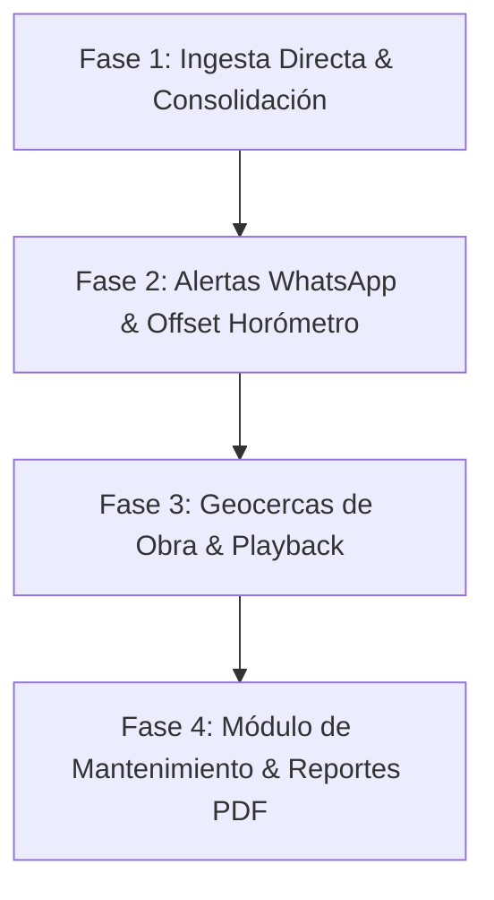

# Investigación de Campo, Benchmark y Plan de Mejoras
## Plataforma IoT Tokioba vs. Competencia (Traccar, GPSWOX, Wialon, Samsara)

Este documento recopila el análisis de campo, la comparación técnica y funcional frente a las principales plataformas del mercado, las demandas habituales de los clientes en operaciones reales, y el plan de mejoras y nuevas funcionalidades para diferenciar y potenciar la plataforma IoT de **Tokioba**.

---

## 1. Comparativa de Plataformas: Tokioba vs. Competencia

| Dimensión | Traccar | GPSWOX | Wialon (Gurtam) | Tokioba IoT (Estado Actual) | Tokioba IoT (Objetivo Diferencial) |
| :--- | :--- | :--- | :--- | :--- | :--- |
| **Enfoque Principal** | AVL genérico (vehículos livianos/fletes) | Flotas y logística estándar (marca blanca) | Telemática pesada multipropósito | Maquinaria, mesas vibratorias y activos industriales | **Vertical industrializada de maquinaria y activos críticos** |
| **Experiencia de Usuario (UI/UX)** | Anticuada, rígida, orientada a instaladores | Tradicional, sobrecargada de submenús | Muy compleja, curva de aprendizaje alta | Moderna, estética oscura, rápida e intuitiva | **Dashboard operativo de 5 segundos (cero fricción visual)** |
| **Integración con Maquinaria** | Mínima (solo muestra coordenadas crudas) | Baja (no especializada en obra) | Avanzada pero difícil de configurar | Horómetro, batería, encendido y vibración | **Detección trabajo vs. ralentí, horas de vibración y ciclos** |
| **Alertas en Tiempo Real** | Básicas (Email / SMS con pasarelas) | Email, Push y SMS costosos | Email, app móvil, webhook | Notificaciones en pantalla (básicas) | **Alertas directas a WhatsApp y grupos de Telegram** |
| **Geocercas de Obra** | Círculos y polígonos genéricos | Sí, con reportes estándar | Sí, geocercas avanzadas | Pendiente | **Corrales de obra con detección de salida y control horario** |
| **Mantenimiento Preventivo** | Rudimentario | Básico por odómetro | Avanzado por horas/km | Pendiente | **Plan de service por horas de motor, checklist y alertas** |
| **Costos de Licenciamiento** | Open-source (requiere server) | SaaS mensual por activo o compra cara | $0.80 - $1.50 USD/mes por objeto | 100% propio (cero costo de terceros) | **Margen neto > 85% para Tokioba** |

---

## 2. Reclamos y Demandas Habituales de los Clientes (Pain Points)

A partir del relevamiento de necesidades en empresas de construcción, alquiler de equipos, logística y servicios industriales, los principales reclamos respecto a las plataformas tradicionales son:

1. **Sobrecarga de información innecesaria:**
   * *El reclamo:* Las plataformas como Traccar o Wialon tienen cientos de opciones de protocolo, geocodificadores y tablas que el operador de obra no entiende ni necesita.
   * *La demanda:* El dueño o jefe de taller quiere abrir la pantalla en el celular o PC y saber en 5 segundos:
     * ¿Dónde está la máquina?
     * ¿Está encendida o apagada?
     * ¿Cuántas horas trabajó hoy?
     * ¿Tiene batería suficiente?
2. **Alertas que nadie lee (El problema del email):**
   * *El reclamo:* Si una máquina se enciende a las 23:30 hs o sale del predio un domingo, un correo electrónico no despierta a nadie y se detecta el robo al día siguiente.
   * *La demanda:* Notificaciones inmediatas a un canal que siempre esté abierto: **WhatsApp o Telegram**.
3. **Desfasaje del horómetro con el tablero físico:**
   * *El reclamo:* El rastreador GPS empieza a contar horas desde el momento en que se instala (0 hs), mientras que la máquina ya tiene acumuladas 2.450 horas en su reloj mecánico.
   * *La demanda:* Poder configurar un **offset inicial de horas** para que la plataforma refleje exactamente lo que marca el contador físico de la máquina.
4. **Falta de visibilidad sobre trabajo efectivo vs. ralentí:**
   * *El reclamo:* El cliente ve que el motor estuvo prendido 8 horas, pero la máquina solo produjo 3 horas; las otras 5 horas el motor quedó regulando con el aire prendido, consumiendo combustible y sumando desgaste inútil.
   * *La demanda:* Diferenciar claramente:
     * Horas de trabajo real (movimiento, vibración o toma de fuerza).
     * Horas de ralentí (*idling* / desperdicio de combustible).
5. **Vencimientos y mantenimientos olvidados:**
   * *El reclamo:* No existe un aviso predictivo que alerte con antelación que faltan 20 horas para el service de 500 horas, derivando en roturas costosas.
   * *La demanda:* Alertas automáticas de service y registro histórico de reparaciones.

---

## 3. ¿Qué Podemos Mejorar en la Plataforma Actual?

### A. Ingesta Directa y Desacople de Servidores Externos
* **Situación:** La integración previa dependía de servidores demo externos de Traccar que presentaban caídas o falta de historial.
* **Mejora:** Implementar el colector probado en la PoC de GPSWOX/Teltonika dentro de `telemetry_api` en FastAPI. Esto permite almacenar directamente en PostgreSQL todos los parámetros telemáticos (`speed`, `battery`, `io113`, `enginehours`, `odometer`, `tail_coordinates`), logrando autonomía absoluta.

### B. Calibración y Offset de Horómetro
* Incorporar en la base de datos el campo `initial_engine_hours_offset` por cada dispositivo.
* Horómetro visible = `Offset inicial + Horas telemáticas acumuladas`.

### C. Agrupamiento Inteligente de Paradas
* Cuando el vehículo/equipo pasa varias horas estacionado, compactar los cientos de paquetes de `0 km/h` en un único bloque de resumen en la interfaz:
  * *Ejemplo:* `"Detenido en Base Vicente López: 6h 15m (desde 20:36 hs)"*.
* Evitar la saturación del historial y agilizar la visualización de los eventos importantes.

### D. Reproductor de Rutas Animado (Playback con Timeline)
* Añadir un control deslizante de tiempo (*slider*) con botón de "Play" para reproducir visualmente los trayectos del día sobre el mapa Leaflet, mostrando la evolución de velocidad y paradas paso a paso.

### E. Comunicación en Tiempo Real por WebSockets / SSE
* Sustituir el sondeo periódico HTTP por una conexión WebSocket o Server-Sent Events, permitiendo que cada nuevo dato transmitido por el Teltonika actualice el mapa y los KPIs de manera instantánea sin recargar la página.

---

## 4. Nuevas Funcionalidades para Destacar (Propuesta de Valor)

### 🚀 1. Motor de Notificaciones a WhatsApp y Telegram
* **Casos de activación inmediata:**
  * 🔴 **Encendido fuera de horario laboral:** Aviso anti-robo nocturno o de fines de semana.
  * 🪫 **Batería crítica:** Aviso cuando la batería baja del 20% (ej. `3.48 V`).
  * 🔌 **Corte de alimentación externa:** Aviso si desconectan la batería principal de la máquina.
  * ⚠️ **Exceso de velocidad o impacto:** Aviso si la máquina es transportada o remolcada a velocidad no habitual.

### 🏗️ 2. Geocercas de Obra / Corrales Virtuales
* Dibujado intuitivo sobre el mapa de polígonos correspondientes a obradores, canteras, depósitos o plantas.
* Detección automática y registro de:
  * Hora de ingreso y egreso.
  * Tiempo total de permanencia en cada frente de obra.
  * Alerta de salida no autorizada.

### 🛠️ 3. Módulo de Mantenimiento y Servicios (Service Planner)
* Parametrización de planes preventivos:
  * Service menor (cada 250 hs).
  * Service integral (cada 500 / 1000 hs).
  * Vencimientos por fecha: Seguro, VTV, habilitación municipal.
* Indicador visual tipo barra de progreso: *"Faltan 18.5 hs para el próximo cambio de aceite"*.
* Historial de órdenes de trabajo con costos de repuestos asociados.

### 💰 4. Calculadora de Costos Operativos y Desperdicio de Ralentí
* Permite cargar un valor estimado por hora de operación de motor (combustible + desgaste).
* Muestra en el panel gerencial:
  * *Horas productivas vs. horas de ralentí.*
  * *Dinero desperdiciado en combustible por motor encendido sin producir.*
* Este módulo constituye una herramienta comercial de alto impacto para la venta del servicio.

### 📄 5. Reporte Ejecutivo Semanal Automatizado (PDF)
* Envío programado todos los lunes a las 8:00 AM al correo electrónico del cliente:
  * Resumen de horas trabajadas por equipo.
  * Kilómetros transitados.
  * Picos de velocidad registrados.
  * Listado de alertas generadas en la semana.

---

## 5. Roadmap Sugerido de Implementación

1. **Fase 1 (Inmediata):** Integrar el conector directo probado en la PoC a la plataforma principal para independizarse de Traccar.
2. **Fase 2 (Corto Plazo):** Implementar la calibración de horómetros por máquina y las alertas críticas a Telegram/WhatsApp.
3. **Fase 3 (Mediano Plazo):** Añadir geocercas interactivas en Leaflet y el reproductor de recorridos.
4. **Fase 4 (Comercial / Escala):** Lanzar el módulo de mantenimiento preventivo y los reportes ejecutivos en PDF.
