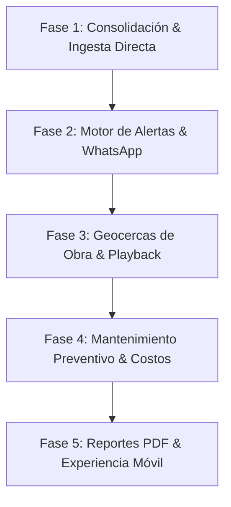

# Plan de Acción Estratégico y Técnico (Versión 2)
## Transformación de la Plataforma Tokioba IoT a Producto Competitivo de Mercado

---

## 1. Visión y Posicionamiento del Producto

El objetivo central de este plan es transformar la plataforma actual de un "visualizador de coordenadas GPS genérico" en un **Sistema Integral de Inteligencia Telemática y Mantenimiento de Maquinaria (Asset & Heavy Fleet Intelligence)**.

Para ganar mercado frente a soluciones tradicionales como Traccar (demasiado técnica y fea) o GPSWOX / Wialon (genéricas y caras), Tokioba debe competir en una categoría especializada donde los clientes pagan con gusto: **Control Operativo de Obra, Ahorro de Combustible por Ralentí, Alertas Directas a WhatsApp y Mantenimiento Preventivo por Horómetro Real.**

```
┌────────────────────────────────────────────────────────────────────────┐
│                        PROPUESTA DE VALOR TOKIOBA                      │
├───────────────────────────────────┬────────────────────────────────────┤
│ Plataformas Genéricas (Traccar)   │ Plataforma Tokioba IoT v2          │
├───────────────────────────────────┼────────────────────────────────────┤
│ • Muestra "el auto en el mapa"    │ • Gestión de maquinaria y obra     │
│ • Horómetro descalibrado          │ • Horómetro calibrado con tablero  │
│ • Alertas por email (nadie lee)   │ • Alertas inmediatas a WhatsApp    │
│ • Datos crudos sin valor de plata │ • Reporte de costo por ralentí     │
│ • No avisa services ni roturas    │ • Planificador de mantenimiento    │
└───────────────────────────────────┴────────────────────────────────────┘
```

---

## 2. Fases de Desarrollo e Implementación



---

### Fase 1: Consolidación de Ingesta, Autonomía y Calibración
> **Objetivo:** Independizarse totalmente de servidores demo externos, consolidar la ingesta probada en la PoC e incorporar parámetros reales de maquinaria en la base de datos PostgreSQL.

#### 1.1 Ingesta Telemática Directa en Backend / Traccar Local
* **Topología de Red Validada:**
  * **Túnel de Telemetría (Playit.gg):** `practically-containers.tun.ply.gg:64501` (UDP) $\rightarrow$ `127.0.0.1:5027` (Pi).
  * **Túnel Web (Zrok):** `https://iot-web-portal.shares.zrok.io` $\rightarrow$ `web:80` (Dashboard).
* **Estrategia de Ingesta:** Recepción en puerto 5027 mediante Traccar Headless ultraliviano en Docker (`-Xmx180m`) o Listener nativo Python Teltonika (Codec 8) integrado en FastAPI.
* **Frecuencia de sincronización / ingesta:** En tiempo real vía UDP/TCP o sondeo local a base de datos cada 5 a 15 segundos con almacenamiento en búfer ante contingencias.
* **Persistencia en PostgreSQL:** Almacenar en `telemetry_events` y `device_states`:
  * Batería externa e interna (voltaje y %).
  * Sensores Teltonika (`io68` corriente, `io113` nivel de carga, `io16` ignición).
  * Horómetro real en segundos y horas.
  * Odómetro acumulado total en km.
  * Conductor asignado y teléfono de contacto.

#### 1.2 Calibración de Horómetros (Offset Inicial de Tablero)
* **Problema resuelto:** Los clientes reclaman que el horómetro del GPS no coincide con el reloj analógico de la máquina.
* **Acción en base de datos:** Agregar en el modelo `Device`:
  * `initial_engine_hours_offset` (Float, default 0.0).
* **Fórmula calculada en backend:**
  $$\text{Horas Totales} = \text{initial\_engine\_hours\_offset} + \frac{\text{segundos telemáticos}}{3600}$$
* **Interfaz de usuario:** En la ventana de "Editar Dispositivo", permitir que el operador configure el valor inicial de horas de tablero.

#### 1.3 Muestreo Inteligente y Compactación de Paradas
* **Acción:** Algoritmo de filtrado en ingesta: si la máquina lleva más de 5 minutos quieta con velocidad 0 en las mismas coordenadas, no saturar la base de datos con un registro por minuto; consolidar el tiempo de parada acumulado y registrar eventos solo ante cambios de estado (arranque, movimiento o alerta).

---

### Fase 2: El Gran Diferenciador: Motor de Alertas en Tiempo Real (WhatsApp / Telegram)
> **Objetivo:** Proveer la función que más valor aporta y que casi ningún competidor ofrece de forma nativa sin costos exorbitantes: notificar al WhatsApp del cliente ante situaciones críticas.

#### 2.1 Motor de Reglas de Eventos (Event Engine en FastAPI)
Monitorear cada paquete ingresado y contrastarlo contra reglas configurables por operador:
* 🔴 **Encendido fuera de horario:** Ignición `true` entre las 20:00 y las 06:00 hs o fines de semana (anti-robo).
* 🪫 **Batería crítica del tracker:** Voltaje $< 3.5\text{ V}$ o carga $< 20\%$.
* 🔌 **Corte de alimentación principal:** Desconexión de la batería del vehículo (posible sabotaje).
* ⚠️ **Movimiento sin encendido:** Velocidad $> 5\text{ km/h}$ con ignición `false` (vehículo siendo remolcado o cargado en batea).
* 🚀 **Exceso de velocidad configurable:** Superación del límite fijado para la máquina.

#### 2.2 Canal de Notificación Inmediata
* **Telegram Bot:** Configuración gratuita y directa para canales de capataces o cuadrillas de obra.
* **WhatsApp Cloud API (o pasarela directa):** Mensajes con plantilla aprobada:
  ```
  ⚠️ ALERTA TOKIOBA IoT - MÁQUINA ACT001
  Tipo: Encendido fuera de horario laboral
  Hora: Domingo 23:42 hs
  Ubicación: Vicente López (-34.5381, -58.4915)
  Conductor: Fabian Bruno
  Ver en el mapa: https://app.tokioba.com/map/ACT001
  ```
* **Notificaciones Web en Vivo:** Popups sonoros y banner en el header del Dashboard.

---

### Fase 3: Geocercas de Obra y Reproductor de Rutas (Playback)
> **Objetivo:** Dar control territorial a constructoras y empresas de alquiler, y permitir auditar viajes con un reproductor visual intuitivo.

#### 3.1 Geocercas de Obra ("Corrales Virtuales")
* **Funcionalidad:**
  * Herramienta en Leaflet para dibujar polígonos o círculos directamente sobre el mapa (ej. "Obrador Ruta 8", "Cantera Pilar", "Base Central").
  * Vinculación de máquinas asignadas a esa zona.
* **Eventos calculados automáticamente:**
  * Ingreso a la obra (fecha y hora exacta).
  * Egreso de la obra.
  * Tiempo total de permanencia / horas operadas dentro de la zona.
  * **Alerta inmediata de fuga:** Si la máquina sale del corral virtual sin autorización.

#### 3.2 Reproductor de Trayectorias Interactivo (Route Playback)
* **Funcionalidad:**
  * Barra de tiempo inferior (*Timeline Scrubber*) para consultar cualquier día.
  * Botones de control: *Play, Pausa, Velocidad (1x, 2x, 5x, 10x)*.
  * Marcador vehicular animado que se desplaza por la polilínea mostrando:
    * Velocímetro dinámico en aguja o digital.
    * Estado de motor (encendido/apagado).
    * Sentido de avance con rotación del ícono según el curso GPS.

---

### Fase 4: Mantenimiento Preventivo y Cálculo de Costo por Ralentí
> **Objetivo:** Crear el gancho comercial para cerrar ventas corporativas demostrando retorno de inversión (ROI) directo.

#### 4.1 Módulo de Mantenimiento y Services (Service Planner)
* **Catálogo de Mantenimientos:**
  * Service de 50 hs (engrase, verificación de mangueras).
  * Service de 250 hs (aceite de motor, filtro de combustible).
  * Service de 500 / 1000 hs (aceite hidráulico, correas, filtros de aire).
  * Vencimientos documentales (VTV, Seguro, habilitación).
* **Alertas Predictivas:**
  * Barra de estado por máquina: *"Service de 500 hs: 482 hs acumuladas (faltan 18 hs / ~3 días de trabajo estimado)"*.
  * Notificación automática al jefe de taller cuando faltan menos de 20 hs.
* **Bitácora de Taller:** Botón para registrar *"Service realizado"* con fecha, costo, repuestos y reinicio automático del contador.

#### 4.2 Analítica de Trabajo Efectivo vs. Ralentí (Idling Cost Calculator)
* **Algoritmo de clasificación:**
  * **Apagado:** Ignición `OFF`.
  * **Ralentí (Motor prendido sin producir):** Ignición `ON`, velocidad $0\text{ km/h}$, sin vibración ni toma de fuerza por más de 5 minutos continuos.
  * **Trabajo Efectivo:** Ignición `ON`, con movimiento o vibración activa (`io` de acelerómetro o sensor de impacto).
* **Indicador financiero en el Dashboard:**
  * *Horas trabajadas:* 28 hs (75%).
  * *Horas en ralentí desperdiciadas:* 9.5 hs (25%).
  * *Costo estimado de combustible tirado:* $\approx \$140\text{ USD}$ en la semana.
  * *Argumento para el cliente:* Reducir ese ralentí paga el abono de Tokioba por 5 meses.

---

### Fase 5: Reportes Automatizados y Experiencia Móvil
> **Objetivo:** Profesionalizar la entrega de valor al cliente y facilitar la consulta en el barro y la obra.

#### 5.1 Reporte Ejecutivo Semanal Programado (PDF / Excel)
* Cronjob que se ejecuta todos los lunes a las 08:00 AM.
* Envía un email automático al director de la empresa con un PDF limpio y ejecutivo:
  * Tabla consolidada de máquinas de su cuenta.
  * Horas trabajadas en la semana por cada una.
  * Kilómetros transitados y velocidad máxima.
  * Resumen de alertas ocurridas.
  * Próximos services a vencer.

#### 5.2 Optimización Web Móvil (PWA - Progressive Web App)
* Adaptar el diseño para que el capataz o mecánico lo abra en Chrome/Safari desde el teléfono y pueda instalarlo con el botón *"Agregar a la pantalla de inicio"* como si fuera una app nativa, con accesos rápidos a:
  * *"¿Dónde están todas mis máquinas ahora?"*
  * *"¿Cuál tiene service vencido?"*
  * *"Llamar al conductor"* (botón directo con el teléfono de la ficha).

---

## 3. Matriz de Priorización y Cronograma de Trabajo

| Sprint | Funcionalidad Clave | Impacto en Negocio | Complejidad Técnica | Entregable Concreto |
| :---: | :--- | :---: | :---: | :--- |
| **Sprint 1** | Ingesta Directa Teltonika/GPSWOX a PostgreSQL | 🔴 Crítico | Media | Backend funcionando sin Traccar demo; telemetría completa persistida. |
| **Sprint 1** | Offset de Horómetro en CRUD de Dispositivos | 🔴 Alto | Baja | Campo en DB y modal para igualar horas del tablero de la máquina. |
| **Sprint 2** | Motor de Alertas Inmediatas (Telegram / WhatsApp) | 🔴 Crítico | Media | Bot enviando alertas de encendido nocturno, batería baja y remolque. |
| **Sprint 2** | Agrupamiento de Paradas y Filtros en Historial | 🟡 Medio | Baja | Historial limpio que compacta horas de parada y resalta velocidades. |
| **Sprint 3** | Módulo de Geocercas de Obra (Corrales Virtuales) | 🔴 Alto | Media | Dibujar polígonos en Leaflet y detectar entrada, permanencia y fuga. |
| **Sprint 3** | Reproductor de Recorridos (Route Playback) | 🟡 Medio | Media | Barra de tiempo y animación del vehículo en el mapa con velocímetro. |
| **Sprint 4** | Módulo de Mantenimiento Preventivo (Service Planner)| 🔴 Crítico | Media | Alertas de service por horas de motor y registro histórico de taller. |
| **Sprint 4** | Cálculo de Costo de Combustible por Ralentí | 🔴 Alto | Baja | KPI gerencial de horas efectivas vs. horas perdidas en ralentí. |
| **Sprint 5** | Generación de Reportes Ejecutivos Semanales en PDF | 🟡 Medio | Media | Envío automático de resumen semanal por correo todos los lunes. |
| **Sprint 5** | Experiencia PWA para Celulares en Obra | 🟡 Medio | Baja | App web ligera con instalación en inicio y vista rápida para capataces. |

---

## 4. Indicadores de Éxito del Producto (KPIs de Validación)

1. **Retención de Clientes (*Churn Rate* $< 2\%$):** Gracias a las alertas de WhatsApp y el módulo de mantenimiento, el cliente percibe el sistema como imprescindible para su operación diaria.
2. **Ticket Promedio por Activo:** Lograr posicionar la suscripción en **$25 a $32 USD / mes** (frente a los $10-$15 USD de plataformas básicas de fletes).
3. **Tiempo de Implementación por Máquina:** Menos de 15 minutos para asociar un nuevo IMEI de Teltonika, calibrar su horómetro inicial y dejarlo transmitiendo al dashboard.
4. **Margen Bruto de Software:** Mantener los costos de infraestructura y datos por debajo del **10% del ingreso mensual**, asegurando un margen neto superior al **90%**.
