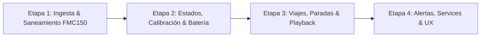

# Plan de Acción Estratégico y Técnico (Versión 3)
## Plataforma Custom de Telemetría IoT & Gestión Inteligente de Flotas y Activos (Tokioba IoT)

---

## 1. Visión y Posicionamiento Exclusivo (Plataforma Custom)

Este documento maestro define la hoja de ruta integral de nuestra **Plataforma Custom Tokioba IoT** (FastAPI + PostgreSQL + React SPA / Leaflet), tomando como punto de partida la telemetría real recibida en producción desde el hardware **Teltonika FMC150** (`Van Operarios`, IMEI `863238073460331`).

### 1.1 Directiva de Arquitectura: Traccar Silencioso en Background
> **DIRECTIVA CLAVE:** Traccar queda relegado única y exclusivamente a cumplir el rol de **motor de ingesta en segundo plano** (puerto 5027 TCP/UDP $\rightarrow$ reenvío HTTP JSON vía `forward.url` a `/api/ingest/traccar`). 
> 
> **Ningún cliente ni operador interactuará con la interfaz gráfica de Traccar**. Todo el valor de negocio, visualización, reportería, alertas y gestión de mantenimiento reside al 100% en nuestra **Plataforma Custom Tokioba**.

```
┌────────────────────────────────────────────────────────────────────────┐
│             ARQUITECTURA DE DATOS: PLATAFORMA CUSTOM TOKIOBA           │
└──────────────────────────────────┬─────────────────────────────────────┘
                                   │
              Dispositivo FMC150   │ GSM / GPRS (Claro AR)
              (Van Operarios)      │ Puerto 5027 TCP/UDP
                                   ▼
          ┌─────────────────────────────────────────────────┐
          │      Traccar Engine (Headless / Silent)         │
          │   Decodifica tramas Teltonika Codec 8/8E        │
          └────────────────────────┬────────────────────────┘
                                   │ HTTP POST (PositionForwarderJson)
                                   ▼
          ┌─────────────────────────────────────────────────┐
          │   FastAPI Ingestion Engine (/api/ingest/traccar) │
          │  • Decodificador AVL FMC150 (io200, io69, etc)  │
          │  • Normalización robusta (Anti-Falsy Bug)       │
          │  • Motor de Estados (Movimiento/Ralentí/Sleep)  │
          │  • Odómetro / Horómetro Calibrado con Tablero   │
          └───────────────┬─────────────────┬───────────────┘
                          │                 │
                          ▼                 ▼
          ┌───────────────────────┐ ┌───────────────────────┐
          │ PostgreSQL Relacional │ │ Live Stream SSE       │
          │  • TelemetryEvents    │ │ EventSource en tiempo │
          │  • DeviceStates       │ │ real hacia clientes   │
          │  • VehicleTrips       │ └───────────┬───────────┘
          │  • MaintenancePlans   │             │
          └───────────┬───────────┘             │
                      │                         │
                      └────────────┬────────────┘
                                   ▼
          ┌─────────────────────────────────────────────────┐
          │      Plataforma Custom Tokioba Web (React SPA)  │
          │  • Dashboard de Flota & Monitoreo en Vivo       │
          │  • Salud Eléctrica del Vehículo (Batería 12V)   │
          │  • Calibrador de Odómetro y Horómetro Físico    │
          │  • Historial de Viajes, Paradas y Ralentí       │
          │  • Alertas de Sabotaje, Grúa y Mantenimiento    │
          └─────────────────────────────────────────────────┘
```

---

## 2. Insumo Técnico: Auditoría Empírica del Payload Real `FMC150_331`

A partir de la trama real recibida desde la *Van Operarios* (IMEI `863238073460331`), se determinaron las siguientes anomalías y oportunidades de ingeniería:

```json
{
  "id": 0,
  "attributes": {
    "priority": 0,
    "sat": 0,
    "event": 0,
    "ignition": false,
    "motion": false,
    "rssi": 5,
    "io200": 3,
    "io69": 3,
    "power": 12.447,
    "battery": 0,
    "io68": 0,
    "operator": 722310,
    "odometer": 35500,
    "distance": 0,
    "totalDistance": 14397775.444186496
  },
  "deviceId": 1307,
  "protocol": "teltonika",
  "serverTime": "2026-10-25T21:10:59.242+00:00",
  "deviceTime": "2026-10-25T21:10:23.000+00:00",
  "fixTime": "2026-10-25T21:10:23.000+00:00",
  "valid": false,
  "latitude": -34.5496566,
  "longitude": -58.4948666,
  "altitude": 0,
  "speed": 0,
  "course": 0,
  "address": null,
  "accuracy": 0,
  "network": null,
  "geofenceIds": null,
  "speed_kmh": 0,
  "device_uniqueId": "863238073460331",
  "device_name": "Van  Operarios",
  "normalized": {
    "ignition": false,
    "motion": false,
    "power": 12.45,
    "battery": 0,
    "totalDistance": 14397775.444186496,
    "hours": null,
    "sat": null,
    "rssi": 5,
    "serverTime": "2026-10-25T21:10:59.242+00:00"
  }
}
```

### 2.1 Hallazgos Críticos de la Auditoría Técnica

1. **Bug de Falsy Values (`sat: 0` $\rightarrow$ `null`):**
   - **Causa Raíz:** En `backend/app/api/ingest.py` (Línea 212), la expresión `sat = attrs.get("sat") or attrs.get("io21")` evalúa el entero `0` como `False`. Al no existir `io21`, la expresión se resuelve en `None` (`null` en JSON).
   - **Impacto:** Ocurre idéntico problema en `battery_val` (cuando la batería interna es 0V o no está conectada, en UI se muestra `"N/A"` en lugar de `0.00 V`), en `totalDistance` y en `speed`.
   - **Corrección Mandatoria:** Sustituir todos los operadores booleanos de coalescencia `or` por comprobaciones explícitas de existencia `is not None` o funciones auxiliares seguras:
     ```python
     def coalesce(*values):
         for v in values:
             if v is not None:
                 return v
         return None
     ```

2. **Decodificación de Códigos AVL Teltonika FMC150:**
   - **`io200: 3` (Modo de Ahorro / Sleep Mode):** Indica que el tracker se encuentra en **Online Deep Sleep Mode**. El módem GSM permanece registrado en la red celular y responde a pings de red o eventos, pero el módulo GNSS y el microprocesador reducen su consumo al mínimo para preservar la batería del vehículo.
   - **`io69: 3` (Estado del Módulo GNSS):** Corresponde a *GNSS Sleep / Powered Off*. Esto demuestra con rigor empírico que `valid: false` y `sat: 0` **no son una falla de cobertura ni un error de hardware**, sino el comportamiento de conservación energética esperado cuando el vehículo se encuentra estacionado con ignición apagada (`ignition: false`).
   - **`io68: 0` (Corriente de Batería Interna):** Reporta 0 mA. La batería de respaldo no está demandando corriente de carga ni alimentando el equipo (el módem se nutre de la batería externa principal `power: 12.447 V`).
   - **`operator: 722310` (Red Móvil):** Código de red celular compuesto por MCC `722` (Argentina) y MNC `310` (Claro AR - AMX Argentina S.A.). El sistema debe decodificarlo para mostrar al operador `"Claro AR"` en lugar de un código crudo ininteligible.

3. **Discrepancia de Odómetros y Horómetro Nulo:**
   - `attributes.odometer = 35500` (metros = 35.5 km): Odómetro de viaje o acumulado desde el último reset de hardware.
   - `attributes.totalDistance = 14397775.44` (metros = ~14.397,77 km): Odómetro GPS acumulado absoluto calculado por el dispositivo.
   - `normalized.hours = null`: El FMC150 no tiene habilitado el elemento telemático de horómetro virtual (`io243`). Por ende, nuestra **Plataforma Custom debe calcular, acumular y persistir el horómetro en base al delta de tiempo en que `ignition: true`**, y permitir ingresar un `initial_engine_hours_offset` y un `odometer_offset_km` para emparejar el tablero del vehículo real.

4. **Saneamiento de Strings:**
   - `device_name` contiene un doble espacio tipográfico (`"Van  Operarios"`). La ingesta debe aplicar saneamiento automático con expresiones regulares (`re.sub(r'\s+', ' ', name).strip()`).

---

## 3. Evaluación de `plan_v2.md` vs. Estado Real del Repositorio

| Eje de `plan_v2.md` | Estado Real en Código | Diagnóstico y Brecha Técnica |
| :--- | :---: | :--- |
| **Ingesta Directa y Traccar Headless** | 🟢 **100% Cumplido** | Traccar recibe en puerto 5027 y reenvía vía HTTP a `/api/ingest/traccar`. Persistencia en `telemetry_events` y `device_states`. |
| **Multi-Tenancy y Privacidad de Flota** | 🟢 **100% Cumplido** | Aislamiento estricto por `user_id` en todos los endpoints de lectura. Super Admin gobierna cuentas sin acceso a telemetría. |
| **Live Stream de Consola en Tiempo Real** | 🟢 **100% Cumplido** | Endpoint SSE `/api/live/stream` y componente `LiveConsoleModal.jsx` para diagnóstico en vivo. |
| **Extracción de Sensores Teltonika** | 🟡 **A medio camino** | Extrae `power`, `battery`, `rssi`, pero con bug de falsy values (`sat: 0 -> null`) y sin decodificar IOs avanzados (`io200`, `io69`, `operator`). |
| **Calibración de Horómetro y Odómetro** | 🔴 **Pendiente** | El modelo `Device` no posee `engine_hours_offset` ni `odometer_offset_km`. No existe UI para calibrar con el tablero físico. |
| **Máquina de Estados de Negocio** | 🟡 **A medio camino** | Solo clasifica en `OPERANDO`, `DETENIDA` y `SIN COMUNICACIÓN`. No detecta **Ralentí** ni reconoce el estado **Estacionado (Modo Ahorro)** con `io200: 3`. |
| **Módulo de Viajes, Paradas y Replay** | 🔴 **Pendiente** | No existe segmentación automática de recorridos ni reproductor con barra de tiempo (*Timeline Scrubber*) en Leaflet. |
| **Mantenimiento Preventivo (Service Planner)** | 🔴 **Pendiente** | No existen tablas ni vistas para configurar services predictivos por km u horas de motor. |
| **Alertas Preventivas (Batería, Sabotaje, Grúa)** | 🔴 **Pendiente** | Sin motor de reglas en backend para alertar batería baja (<11.8V), alternador defectuoso o movimiento sin ignición. |
| **Limpieza de Servicios Obsoletos** | 🟡 **A medio camino** | `traccar_sync.py` quedó como código muerto no importado en `main.py` pero consumiendo espacio y generando confusión. |

---

## 4. Funcionalidades de Alto Valor para Clientes Finales

Diseñadas específicamente para dueños de flotas, jefes de taller y encargados de operaciones:

### 4.1 Máquina de Estados Operativos Inteligentes
Reemplazo de los estados técnicos crudos por semántica operacional intuitiva:
1. 🟢 **En Movimiento:** `ignition: true` AND `speed_kmh >= 3.0` (o `motion: true`).
2. 🟡 **Ralentí (Motor Encendido Detenido):** `ignition: true` AND `speed_kmh < 3.0` AND `motion: false` por más de 120 segundos. 
   - *Valor para el cliente:* Permite medir el desperdicio de combustible y el desgaste innecesario del motor en paradas de reparto o esperas en obra.
3. 🔵 **Estacionado (Modo Ahorro / Online):** `ignition: false` AND (`io200 == 3` OR reporte periódico reciente $< 30\text{ min}$).
   - *Valor para el cliente:* Evita el pánico infundado cuando el cliente ve `valid: false` o satélites en 0; la plataforma le confirma que la unidad está a salvo descansando con ahorro de batería.
4. 🔴 **Sin Reporte / Desconectado:** Tiempo desde el último reporte $> 30\text{ min}$ sin heartbeat.
5. 🟣 **Alerta de Remolque / Grúa (Movimiento No Autorizado):** `ignition: false` AND `speed_kmh > 5.0` (o `motion: true`).

### 4.2 Salud Eléctrica del Vehículo y Detección de Sabotaje
- **Batería Principal del Vehículo (`power: 12.447 V`):**
  - **Estado Normal / Reposo:** $12.2\text{ V} - 12.8\text{ V}$ (Óptimo).
  - ⚠️ **Alerta Preventiva de Batería Baja:** $< 11.8\text{ V}$ con motor apagado. Avisa al jefe de flota antes de que el vehículo no pueda arrancar al día siguiente.
  - ⚡ **Verificación de Alternador:** Con motor encendido (`ignition: true`), el voltaje debe subir a $> 13.5\text{ V}$. Si permanece por debajo de $12.5\text{ V}$ con motor en marcha, genera alerta de *Falla de Alternador / Correa*.
  - 🚨 **Alerta de Desconexión / Sabotaje:** Caída abrupta de `power` a $0\text{ V}$ con traspaso a batería interna de respaldo.
- **Batería Interna del Tracker (`battery: 0 V`):**
  - Detección de presencia, carga y autonomía residual ante desconexión de borne.

### 4.3 Odómetro y Horómetro Calibrables (Espejo de Tablero)
- La Van Operarios marca en su odómetro real un valor superior a los $14.397\text{ km}$ virtuales del GPS.
- Configuración en la ficha del equipo:
  - `odometer_offset_km`: Offset sumado a la distancia total telemática:
    $$\text{Km en Pantalla} = \text{odometer\_offset\_km} + \frac{\text{totalDistance}}{1000}$$
  - `engine_hours_offset`: Horas de motor iniciales sumadas a las acumuladas por la plataforma:
    $$\text{Horas Totales} = \text{engine\_hours\_offset} + \text{engine\_hours\_acumuladas}$$

### 4.4 Módulo de Viajes, Paradas y Reproductor de Rutas (Playback)
- **Segmentación Automática de Viajes (`VehicleTrip`):**
  - **Inicio de Viaje:** Transición `ignition: false` $\rightarrow$ `ignition: true`.
  - **Fin de Viaje:** `ignition: false` sostenido por más de 3 minutos.
  - **Métricas calculadas por viaje:** Hora salida/llegada, duración total, distancia recorrida en km, velocidad máxima, velocidad promedio, y **tiempo exacto en ralentí**.
- **Reproductor de Recorridos en Leaflet:**
  - Control de reproducción: Play, Pausa, velocidad variable ($1\times, 2\times, 5\times, 10\times$).
  - Marcador animado con orientación según el ángulo de rumbo (`course`).
  - Velocímetro y tacómetro dinámicos sincronizados con la barra de tiempo (*Timeline Scrubber*).

### 4.5 Mantenimiento Preventivo (Service Planner)
- Creación de planes de mantenimiento por activo:
  - *Cambio de Aceite y Filtros:* Cada $10.000\text{ km}$ o $250\text{ hs}$.
  - *Filtro de Aire y Combustible:* Cada $20.000\text{ km}$.
  - *Distribución / Correas:* Cada $60.000\text{ km}$.
  - *Vencimiento de VTV / Seguro:* Por fecha calendario.
- Indicador visual semaforizado en el Dashboard:
  - 🟢 Normal ($> 1.000\text{ km}$ o $> 30\text{ hs}$ restantes).
  - 🟡 Próximo ($< 1.000\text{ km}$ o $< 30\text{ hs}$).
  - 🔴 Vencido ($0\text{ km}$ o fecha expirada).
- Botón de "Registrar Service Realizado" con bitácora de costos y reseteo automático de contador.

### 4.6 Diagnóstico Transparente de Red y Módulo GPS
- Decodificación automática de red celular: `operator: 722310` $\rightarrow$ `"Claro AR"`.
- Barras de nivel de señal GSM (RSSI $5/5$ = Excelente).
- Estado del receptor GNSS: Decodificación de `io69` (Activo / En Búsqueda / Sleep Mode Ahorro).

---

## 5. Roadmap de Implementación en 4 Etapas Incrementales

Este plan de trabajo está estructurado en **4 etapas independientes, ordenadas y ejecutables ticket por ticket** por el equipo de ingeniería y Antigravity:



---

### ETAPA 1: Saneamiento de Datos, Bugfixes de Normalización y Decodificación FMC150
> **Objetivo:** Erradicar los bugs de valores falsy en el backend, decodificar los parámetros AVL específicos del Teltonika FMC150 (`io200`, `io69`, `io68`, `operator`), sanitizar textos y persistir métricas consistentes en PostgreSQL.

#### 1. Archivos a Modificar / Crear
* `backend/app/services/fmc150_decoder.py` *(Nuevo)*: Servicio especializado de interpretación telemática Teltonika (modos de suspensión, estados GNSS, diccionario MCC/MNC para Argentina).
* `backend/app/api/ingest.py`: Refactorización del método `ingest_traccar` reemplazando los operadores `or` por coalescencia estricta `is not None`, extracción limpia de `power`, `battery`, `io200`, `io69`, `operator` y saneamiento de `device_name`.
* `backend/app/models/models.py`: Incorporación de columnas estructuradas en `TelemetryEvent` y `DeviceState` (`external_power`, `internal_battery`, `gnss_status`, `sleep_mode`, `network_operator`).
* `backend/init_db.py`: Migraciones no destructivas `ALTER TABLE ... ADD COLUMN IF NOT EXISTS` para las nuevas columnas.
* `backend/app/schemas/schemas.py`: Actualización de schemas Pydantic para reflejar los nuevos datos decodificados.

#### 2. Cambios en Base de Datos
```sql
ALTER TABLE telemetry_events ADD COLUMN IF NOT EXISTS external_power FLOAT;
ALTER TABLE telemetry_events ADD COLUMN IF NOT EXISTS internal_battery FLOAT;
ALTER TABLE telemetry_events ADD COLUMN IF NOT EXISTS sleep_mode INTEGER;
ALTER TABLE telemetry_events ADD COLUMN IF NOT EXISTS gnss_status INTEGER;
ALTER TABLE telemetry_events ADD COLUMN IF NOT EXISTS network_operator VARCHAR;

ALTER TABLE device_states ADD COLUMN IF NOT EXISTS external_power FLOAT;
ALTER TABLE device_states ADD COLUMN IF NOT EXISTS internal_battery FLOAT;
ALTER TABLE device_states ADD COLUMN IF NOT EXISTS sleep_mode INTEGER;
ALTER TABLE device_states ADD COLUMN IF NOT EXISTS gnss_status INTEGER;
ALTER TABLE device_states ADD COLUMN IF NOT EXISTS network_operator VARCHAR;
```

#### 3. Criterios de Aceptación
1. Al recibir el payload de prueba `FMC150_331`, `normalized.sat` debe ser `0` (entero) y **nunca `null`**.
2. `normalized.battery` debe ser `0.00` y `normalized.power` debe ser `12.45`.
3. `network_operator` debe resolverse a `"Claro AR"` (o contener `MCC 722 MNC 310`).
4. `device_name` se persiste limpio sin dobles espacios (`"Van Operarios"`).
5. El broadcast del Live Stream SSE refleja: `Bat=0.00V, Power=12.45V, Sat=0, Red=Claro AR`.

#### 4. Pruebas de Validación
* **Prueba de Ingesta Unitaria:** Ejecutar script cURL o Python inyectando el payload exacto de la *Van Operarios* a `/api/ingest/traccar`.
* **Verificación de Base de Datos:** Consultar `SELECT external_power, internal_battery, sleep_mode, gnss_status, network_operator FROM device_states WHERE device_id = '863238073460331'` y validar que ningún campo sea erróneamente nulo.

---

### ETAPA 2: Motor de Estados Operativos, Odómetro/Horómetro Calibrable y Salud de Batería
> **Objetivo:** Dotar a la plataforma de inteligencia de negocio calculando el estado operativo real (Movimiento, Ralentí, Estacionado en Modo Ahorro, Desconectado), permitir al usuario calibrar el odómetro y horómetro con el tablero de su vehículo, y desplegar la tarjeta de salud eléctrica en la UI.

#### 1. Archivos a Modificar / Crear
* `backend/app/models/models.py`:
  - En `Device`: Agregar `odometer_offset_km` (Float, default 0.0) y `engine_hours_offset` (Float, default 0.0).
  - En `DeviceState`: Agregar `operating_status` (String), `calibrated_odometer_km` (Float), `total_idling_hours` (Float).
* `backend/init_db.py`: Añadir las sentencias `ALTER TABLE` correspondientes.
* `backend/app/api/devices.py`:
  - Actualizar lógica `calculate_status` para evaluar:
    * `MOVING` (En Movimiento)
    * `IDLING` (Ralentí)
    * `PARKED_SLEEP` (Estacionado - Modo Ahorro)
    * `DISCONNECTED` (Sin Comunicación)
    * `TOWING` (Alerta Remolque)
  - Endpoints `PUT /api/devices/{device_id}/calibration`: Para fijar los offsets de tablero sin reiniciar contadores de hardware.
* `backend/app/schemas/schemas.py`: Añadir schemas de calibración y nuevos campos en `DeviceStatusResponse`.
* `frontend/src/pages/Dashboard.jsx`:
  - Actualizar tarjetas de métricas en cabecera: Batería Vehículo 12V (con barra de nivel e indicador de salud), Odómetro Calibrado (km), Horómetro Total (hs).
  - Badges de estado con los nuevos 5 estados operativos y colores semánticos.
* `frontend/src/components/DeviceCalibrationModal.jsx` *(Nuevo)*: Modal interactivo para que el operador ingrese el kilometraje y horas reales que marca el tablero de la Van Operarios.

#### 2. Criterios de Aceptación
1. La *Van Operarios* reportando `ignition: false`, `io200: 3` y última posición reciente debe mostrar en el dashboard el badge azul: **"ESTACIONADO (MODO AHORRO)"** en lugar de "DETENIDA" o "SIN COMUNICACIÓN".
2. Si el operador configura en el modal de calibración un offset de $120.000\text{ km}$, el Dashboard refleja $134.397,7\text{ km}$ (sumando los $14.397,7\text{ km}$ del GPS).
3. La tarjeta de Batería muestra `12.45 V` con tag `"Salud Óptima"`, advirtiendo si baja de `11.8 V`.

#### 3. Pruebas de Validación
* **Prueba de Calibración:** Llamar `PUT /api/devices/863238073460331/calibration` con `{"odometer_offset_km": 50000.0, "engine_hours_offset": 1200.0}` y verificar que `/api/devices/863238073460331/status` retorne el odómetro y horómetro sumados.
* **Prueba de Estados:** Inyectar una trama con `ignition: true` y `speed: 0` y verificar que el estado pase a `IDLING` (Ralentí) tras 120 segundos continuos.

---

### ETAPA 3: Limpieza de Redundancias API y Detección de Viajes/Paradas + Ralentí
> **Objetivo:** Limpiar componentes obsoletos del backend (`traccar_sync.py`), implementar el detector automático de viajes y paradas con cálculo de ralentí acumulado, y crear la vista de historial de trayectorias con reproductor visual en React.

#### 1. Archivos a Modificar / Crear
* `backend/app/services/traccar_sync.py`: Deprecar y eliminar formalmente del repositorio este módulo obsoleto de polling HTTP para evitar duplicación de tareas con `ingest.py`.
* `backend/app/models/models.py`:
  - Crear modelo `VehicleTrip` (`id`, `device_id`, `start_time`, `end_time`, `duration_seconds`, `distance_km`, `max_speed_kmh`, `avg_speed_kmh`, `idling_seconds`, `start_lat`, `start_lon`, `end_lat`, `end_lon`, `is_closed`).
* `backend/app/services/trip_detector.py` *(Nuevo)*: Motor de procesamiento que evalúa cada evento ingresado en `ingest.py` y abre, acumula o cierra viajes automáticamente según el ciclo de ignición.
* `backend/app/api/trips.py` *(Nuevo)*: Endpoints para consultar viajes históricos de un activo: `GET /api/devices/{device_id}/trips` con filtrado por rango de fechas.
* `frontend/src/components/TripHistoryModal.jsx` *(Nuevo)*: Panel de consulta de viajes realizados en el día o semana, con desglose de km, tiempo en marcha y costo de combustible por ralentí.
* `frontend/src/components/RoutePlayback.jsx` *(Nuevo)*: Componente Leaflet con barra de tiempo, marcador dinámico orientado por `course`, y controles Play/Pause/Velocidad para reproducir recorridos.

#### 2. Estructura de Datos de Viajes
```sql
CREATE TABLE IF NOT EXISTS vehicle_trips (
    id SERIAL PRIMARY KEY,
    device_id VARCHAR NOT NULL REFERENCES devices(device_id) ON DELETE CASCADE,
    start_time TIMESTAMP WITH TIME ZONE NOT NULL,
    end_time TIMESTAMP WITH TIME ZONE,
    duration_seconds INTEGER DEFAULT 0,
    distance_km FLOAT DEFAULT 0.0,
    max_speed_kmh FLOAT DEFAULT 0.0,
    avg_speed_kmh FLOAT DEFAULT 0.0,
    idling_seconds INTEGER DEFAULT 0,
    start_latitude FLOAT,
    start_longitude FLOAT,
    end_latitude FLOAT,
    end_longitude FLOAT,
    is_closed BOOLEAN DEFAULT FALSE
);
CREATE INDEX IF NOT EXISTS idx_trips_device_time ON vehicle_trips(device_id, start_time DESC);
```

#### 3. Criterios de Aceptación
1. Cada ciclo de encendido $\rightarrow$ marcha $\rightarrow$ apagado de la Van Operarios genera un registro consolidado en `vehicle_trips`.
2. El modal de viajes permite ver el listado de recorridos del día con indicación de hora de inicio, fin, km recorridos y minutos en ralentí.
3. Al presionar "Reproducir Viaje", el mapa anima el movimiento del vehículo sobre la polilínea, actualizando el velocímetro en tiempo real.

#### 4. Pruebas de Validación
* **Prueba de Secuencia de Viaje:** Simular mediante script una secuencia de 5 tramas:
  1. Ignición OFF (vehículo detenido).
  2. Ignición ON, Vel=0 (arranque en ralentí).
  3. Ignición ON, Vel=45 km/h (desplazamiento).
  4. Ignición ON, Vel=0 (detenido en semáforo/ralentí).
  5. Ignición OFF (fin de viaje).
* Validar que se haya cerrado 1 viaje con la distancia, velocidad máxima y tiempo de ralentí correctos.

---

### ETAPA 4: Alertas Operativas, Mantenimiento Preventivo y Experiencia de Usuario Final
> **Objetivo:** Implementar el motor de reglas de alertas (batería baja, corte de alimentación, exceso de velocidad, remolque), el gestor de mantenimiento preventivo (services por km/hs con semáforos) y pulir la experiencia de usuario móvil e industrial.

#### 1. Archivos a Modificar / Crear
* `backend/app/models/models.py`:
  - Crear modelo `MaintenancePlan` (`id`, `device_id`, `title`, `service_type` ['KM', 'HOURS', 'DATE'], `interval_value`, `last_service_value`, `next_service_value`, `due_date`, `is_active`).
  - Crear modelo `VehicleAlert` (`id`, `device_id`, `alert_type`, `severity`, `timestamp`, `message`, `resolved`).
* `backend/app/api/maintenance.py` *(Nuevo)*: CRUD de planes de service y registro de services ejecutados.
* `backend/app/api/alerts.py` *(Nuevo)*: Consulta y resolución de alertas de seguridad del vehículo.
* `backend/app/services/alert_engine.py` *(Nuevo)*: Evaluación síncrona en ingesta de reglas críticas (caída de batería $<11.8\text{V}$, velocidad $> \text{límite}$, movimiento con ignición apagada).
* `frontend/src/components/MaintenancePlannerModal.jsx` *(Nuevo)*: Vista para dar de alta services, visualizar barras de avance y asentar órdenes de trabajo.
* `frontend/src/components/AlertNotificationBell.jsx` *(Nuevo)*: Campana en la barra superior con contador de alertas no leídas y sonido opcional.

#### 2. Criterios de Aceptación
1. Si la Van Operarios reporta `power: 11.50`, el sistema genera automáticamente una alerta de severidad `WARNING`: *"Batería de vehículo baja (11.50 V). Verificar antes de próxima salida"*.
2. Al superar el odómetro fijado para el próximo service (ej. $135.000\text{ km}$), la barra de mantenimiento pasa a color rojo con el texto: *"Service Vencido por 450 km"*.
3. El operador puede pulsar *"Registrar Service"* para ingresar fecha, taller, costo y reiniciar el intervalo al siguiente ciclo ($+10.000\text{ km}$).

#### 3. Pruebas de Validación
* **Prueba de Alerta Eléctrica:** Inyectar trama con `power: 10.8` y verificar la creación inmediata de la fila en `vehicle_alerts` y su aparición en el panel de notificaciones del Frontend.
* **Prueba de Service:** Crear plan de cambio de aceite a los $14.000\text{ km}$; habiendo recorrido $14.397\text{ km}$, verificar que la API marque el service como `status: "OVERDUE"`.

---

## 6. Matriz de Priorización y Dependencias Técnicas

| Etapa | Componentes Afectados | Complejidad | Impacto en Negocio | Dependencias Previas |
| :---: | :--- | :---: | :---: | :--- |
| **Etapa 1** | Backend Ingestion (`ingest.py`, `models.py`, `schemas.py`) | Media | 🔴 **Crítico** | Ninguna (Datos ya ingresando desde FMC150). |
| **Etapa 2** | Backend + Frontend Cards & Calibración (`Dashboard.jsx`) | Media | 🔴 **Crítico** | Requiere Etapa 1 completada. |
| **Etapa 3** | Backend (`trip_detector.py`) + React Playback & Viajes | Media-Alta | 🟡 **Alto** | Requiere Etapa 1 y 2 (Offsets y estados estables). |
| **Etapa 4** | Backend Alertas & Mantenimiento + Modales UI | Media | 🔴 **Crítico** | Requiere Etapa 2 (Odómetro y batería consistentes). |

---

## 7. Garantía de Aislamiento y No Regresión

Para preservar los estándares alcanzados en auditorías previas (Pentesting 100% GREEN, Aislamiento Multi-Tenant estricto y Soporte Zrok):
1. **Multi-Tenancy Obligatorio:** Todos los nuevos endpoints de Viajes, Calibración, Mantenimiento y Alertas deben filtrar obligatoriamente por `Device.user_id == current_user.id`.
2. **Validación WGS84 y Anti-XSS:** Todas las entradas de texto en nuevos formularios (títulos de services, notas de taller) deben validarse contra inyección HTML y caracteres no permitidos en Pydantic.
3. **Persistencia No Destructiva:** Todas las alteraciones de esquema se realizan mediante `ADD COLUMN IF NOT EXISTS`, asegurando cero pérdida de datos históricos de telemetría.
