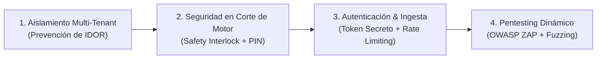

# Plan de Acción Estratégico y Técnico (Versión 4)
## Hoja de Ruta Comercial, Especificación Funcional, Plan de Pentesting y Versionado
### Plataforma Tokioba Telematics & Fleet IoT (v1.0.0 Commercial Release)

---

## 1. Visión del Producto Comercial y Objetivos de Negocio

El proyecto ha completado con éxito las 4 etapas de su núcleo telemático (`plan_v3.md`), alcanzando un **80% de madurez técnica funcional**: ingesta en tiempo real Teltonika FMC150, máquina de 5 estados operativos de negocio, calibración espejo con tablero físico (odómetro y horómetro), diagnóstico de salud de batería de 12V y alternador, detector automático de viajes y paradas con costeo de ralentí en pesos, reproductor animado de rutas (*Route Playback*) y motor de alertas con gestor de mantenimiento preventivo.

**El objetivo de `plan_v4.md` es cerrar el 20% restante para transformar este núcleo técnico en un Producto Comercial Vendible (`v1.0.0`)**, listo para ser comercializado a empresas de transporte, constructoras, servicios petroleros y logística liviana bajo un modelo de suscripción mensual recurrente (SaaS B2B).

---

## 2. Estrategia de Versionado del Producto (Release Management)

Para brindar previsibilidad a los clientes, facilitar el soporte técnico y asegurar la trazabilidad de despliegues, se adopta formalmente el estándar **Semantic Versioning 2.0.0 (`MAJOR.MINOR.PATCH`)**:

```
v1.0.0
 ├── MAJOR (1): Cambio de arquitectura o incompatibilidad mayor de API.
 ├── MINOR (0): Nuevos módulos funcionales (Geocercas, Telegram, Reportes, Corte de Motor).
 └── PATCH (0): Bugfixes de seguridad, optimizaciones de ingesta o ajustes visuales.
```

### 2.1 Cronograma de Releases hacia Producción

| Versión | Nombre Clave | Estado | Alcance / Hitos Principales |
| :---: | :--- | :---: | :--- |
| **`v0.4.0`** | *Core Telematics Baseline* | 🟢 **Completada** | Saneamiento FMC150, Estados Operativos, Calibración, Viajes/Ralentí, Alertas y Mantenimiento. |
| **`v0.5.0`** | *Geofencing & Alerts Dispatcher* | ⏳ **Sprint 1** | Geocercas poligonales/circulares, Bot de Telegram/Email y Control de uso fuera de horario. |
| **`v0.6.0`** | *Executive Reports & Anti-Theft* | ⏳ **Sprint 2** | Generador de Reporte PDF Ejecutivo corporativo y Corte de Motor Remoto con Safety Interlock. |
| **`v1.0.0-rc1`** | *Security Hardening & QA* | ⏳ **Sprint 3** | Pentesting, auditoría de permisos multi-tenant, telemetría de combustible y testing de carga. |
| **`v1.0.0`** | *Commercial Launch (GA)* | 🎯 **Lanzamiento** | Versión de Disponibilidad General para comercialización y alta de clientes finales. |

### 2.2 Trazabilidad de Versión en el Código y en la Interfaz

1. **Backend (`/api/version`):**
   Nuevo endpoint público de introspección que retorna:
   ```json
   {
     "product": "Tokioba Telematics Platform",
     "version": "1.0.0",
     "release_stage": "stable",
     "build_date": "2026-10-25T21:50:00Z",
     "git_commit": "HEAD",
     "environment": "production",
     "supported_codecs": ["Codec 8", "Codec 8 Extended", "Teltonika FMC150"]
   }
   ```
2. **Frontend UI (Footer & Sidebar):**
   Inclusión de un badge discreto en la barra de navegación o pie de página:
   `Tokioba IoT v1.0.0 (Release 2026.10)` con enlace al changelog técnico para operadores.

---

## 3. Matriz de Priorización de Funcionalidades (Ranking de Valor vs. Complejidad)

Se evaluaron todas las funcionalidades demandadas por el mercado B2B frente a dos vectores: **Impacto en el Cierre de Ventas (ROI)** y **Complejidad Técnica de Implementación**.

```
              ALTO ▲  [P0] Notificaciones Telegram/Email   [P0] Geocercas (Polígonos/Zonas)
                   │  [P0] Alerta Fuera de Horario         [P0] Reportes Ejecutivos en PDF
 VALOR COMERCIAL   │  ───────────────────────────────────────────────────────────────────
 / RETORNO (ROI)   │  [P1] Inmovilizador / Corte Motor     [P1] Sensor de Nivel Combustible
                   │  [P2] Score Chofer (Eco-Driving)      [P2] Identificación iButton/RFID
              BAJO ┼─────────────────────────────────────────────────────────────────────►
                   BAJA                             MEDIA                           ALTA
                                          COMPLEJIDAD TÉCNICA
```

### Tabla Maestra de Ranking y Prioridades

| Rank | Funcionalidad | Prioridad | Valor para el Cliente Final | Complejidad | ROI / Justificación Comercial | Sprint |
| :---: | :--- | :---: | :--- | :---: | :--- | :---: |
| **#1** | **Geocercas (Círculos y Polígonos)** | **P0 (Crítica)** | Control de arribo/salida de bases, obras, clientes y canteras. Control de permanencia. | **Media** | Requisito excluyente del 95% de empresas de transporte y servicios. Sin esto no compran. | **Sprint 1** |
| **#2** | **Notificaciones Push Externas (Telegram / Email)** | **P0 (Crítica)** | El dueño/encargado recibe alertas críticas (batería, sabotaje, grúa) directo a su celular 24/7. | **Baja** | Convierte las alertas del sistema en valor tangible de seguridad sin obligar a abrir la web. | **Sprint 1** |
| **#3** | **Control de Uso Fuera de Horario (Anti-Uso Personal)** | **P0 (Crítica)** | Detección inmediata de encendido nocturno o en fines de semana no autorizados. | **Baja** | Ahorro directo en desgaste, seguros y combustible malgastado por choferes. | **Sprint 1** |
| **#4** | **Reporte Ejecutivo Mensual/Semanal en PDF Corporativo** | **P0 (Crítica)** | Informe prolijo para directorio: km recorridos, horas motor, dinero perdido en ralentí y services. | **Media** | Es la herramienta que justifica mensualmente el pago del abono ante el gerente o dueño. | **Sprint 2** |
| **#5** | **Corte de Motor Remoto (Inmovilizador Anti-Robo)** | **P1 (Alto)** | Envío de comando `setdigout 1` a Teltonika para impedir el arranque en caso de robo o mora. | **Media** | Argumento de seguridad patrimonial de alto impacto psicológico y comercial. | **Sprint 2** |
| **#6** | **Monitoreo de Nivel de Combustible (CAN/DUT-E)** | **P1 (Alto)** | Detección de cargas y caídas abruptas (robo/ordeñe de gasoil en tanques). | **Alta** | Clave para flotas pesadas, generadores y camiones de larga distancia. | **Sprint 3** |
| **#7** | **Score de Conducción (Eco-Driving con Acelerómetro)** | **P2 (Expansión)** | Calificación de choferes por frenadas bruscas, aceleraciones y giros agresivos. | **Media** | Reduce siniestralidad y costos de neumáticos en flotas de distribución. | **Sprint 3** |
| **#8** | **Identificación de Conductor (iButton / RFID)** | **P2 (Expansión)** | Registro de qué operario encendió el vehículo mediante llave Dallas 1-Wire. | **Media** | Útil en empresas con choferes rotativos en la misma unidad. | **Sprint 3** |

---

## 4. Especificación Técnica Detallada de las Nuevas Funcionalidades

### 4.1 Sprint 1 (Release `v0.5.0`): Geocercas Inteligentes, Alertas Externas y Control Horario

#### A. Módulo de Geocercas Inteligentes y Control de Permanencia
* **Modelos Relacionales (`backend/app/models/models.py`):**
  ```python
  class Geofence(Base):
      __tablename__ = "geofences"
      id = Column(Integer, primary_key=True, index=True)
      user_id = Column(Integer, ForeignKey("users.id"), nullable=False, index=True)
      name = Column(String(100), nullable=False)
      description = Column(String(255), nullable=True)
      type = Column(String(20), nullable=False, default="POLYGON") # POLYGON, CIRCLE
      # Para círculos:
      center_lat = Column(Float, nullable=True)
      center_lon = Column(Float, nullable=True)
      radius_meters = Column(Float, nullable=True)
      # Para polígonos: Lista JSON de coordenadas [[lat, lon], ...]
      polygon_vertices = Column(JSON, nullable=True)
      color = Column(String(20), default="#3B82F6") # Hex para renderizado en Leaflet
      speed_limit_kmh = Column(Float, nullable=True) # Alerta por exceso de velocidad dentro
      is_active = Column(Boolean, default=True)
      created_at = Column(DateTime, default=datetime.utcnow)

  class GeofenceEvent(Base):
      __tablename__ = "geofence_events"
      id = Column(Integer, primary_key=True, index=True)
      geofence_id = Column(Integer, ForeignKey("geofences.id", ondelete="CASCADE"), nullable=False, index=True)
      device_id = Column(String(50), nullable=False, index=True)
      event_type = Column(String(20), nullable=False) # ENTER, EXIT, OVERSPEED
      timestamp = Column(DateTime, nullable=False, index=True)
      latitude = Column(Float, nullable=False)
      longitude = Column(Float, nullable=False)
      speed_kmh = Column(Float, default=0.0)
      duration_inside_seconds = Column(Integer, nullable=True) # Calculado al registrar EXIT
  ```

* **Algoritmo Geodésico y de Contención (`geofence_engine.py`):**
  - **Círculos:** Distancia ortodrómica Haversine punto-centro $\le \text{radius\_meters}$.
  - **Polígonos (Ray-Casting Algorithm):**
    ```python
    def point_in_polygon(lat: float, lon: float, polygon: list[list[float]]) -> bool:
        inside = False
        n = len(polygon)
        p1_lat, p1_lon = polygon[0]
        for i in range(1, n + 1):
            p2_lat, p2_lon = polygon[i % n]
            if min(p1_lat, p2_lat) < lat <= max(p1_lat, p2_lat):
                if lon <= max(p1_lon, p2_lon):
                    if p1_lat != p2_lat:
                        x_inters = (lat - p1_lat) * (p2_lon - p1_lon) / (p2_lat - p1_lat) + p1_lon
                    if p1_lon == p2_lon or lon <= x_inters:
                        inside = not inside
            p1_lat, p1_lon = p2_lat, p2_lon
        return inside
    ```
  - **Mecanismo Anti-Jitter (Debouncing):** Para evitar que el ruido o deriva GPS cuando el vehículo está detenido al borde de la geocerca dispare múltiples falsas alarmas de `ENTER`/`EXIT`, se requiere una persistencia de estado de al menos 2 posiciones consecutivas o 30 segundos continuos antes de consolidar el cambio de estado.

* **Endpoints REST (`backend/app/api/geofences.py`):**
  - `GET /api/geofences` (Listado del usuario con conteo de vehículos dentro).
  - `POST /api/geofences` (Creación con validación de polígono cerrado $\ge 3$ vértices).
  - `PUT /api/geofences/{id}` (Modificación de coordenadas o límites de velocidad).
  - `DELETE /api/geofences/{id}` (Eliminación con borrado en cascada de eventos).
  - `GET /api/geofences/{id}/events` (Historial de ingresos y salidas con filtros de fecha).

* **Componente UI (`GeofenceManagerModal.jsx`):**
  - Integrado a Leaflet: modo edición con polígonos dibujados haciendo clics sobre el mapa y círculos redimensionables.
  - Indicador visual de unidades dentro en tiempo real con distintivo del color de la geocerca.

#### B. Despachador de Alertas Multicanal (`notification_dispatcher.py`)
* **Integración con Telegram Bot API:**
  - Token de bot seguro y `chat_id` configurable por cliente o flota.
  - Despacho en segundo plano asíncrono sin bloquear el pipeline de ingesta (`asyncio.create_task`).
  - Plantillas enriquecidas con emojis contextuales:
    - 🔴 `CORTE DE ALIMENTACIÓN / BATERÍA CRÍTICA`
    - 🚜 `MOVIMIENTO NO AUTORIZADO (GRÚA / REMOLQUE)`
    - ⛔ `INGRESO / SALIDA DE ZONA SEGURA (GEOCERCA)`
    - 🌙 `ACTIVIDAD FUERA DE HORARIO PERMITIDO`
    - ⚡ `FALLA DE CARGA DEL ALTERNADOR`
* **Integración con Correo Electrónico (SMTP):**
  - Envío automático de notificaciones de incidentes graves y resumen diario matutino consolidado.

#### C. Control de Horarios Operativos (Anti-Uso Personal)
* **Atributos en el modelo `Device`:**
  - `work_schedule_enabled`: Boolean (default False).
  - `work_schedule_start`: Time (ej. `07:00`).
  - `work_schedule_end`: Time (ej. `19:00`).
  - `allowed_weekdays`: String (ej. `"0,1,2,3,4"` = Lunes a Viernes).
* **Regla en `alert_engine.py`:**
  - Si `ignition == True` y `current_time` se encuentra fuera de los rangos o días permitidos, genera alerta `UNAUTHORIZED_SCHEDULE` con severidad `WARNING` y notificación instantánea a Telegram.

---

### 4.2 Sprint 2 (Release `v0.6.0`): Reportes Ejecutivos y Comando Anti-Robo

#### A. Generador de Reportes Ejecutivos en PDF Corporativo
* Servicio backend `backend/app/services/report_generator.py` utilizando `ReportLab`:
  - **Estructura del Documento:**
    1. **Encabezado:** Isotipo corporativo Tokioba, datos del cliente, rango de fechas auditado.
    2. **Scorecard de Flota:** Total de Km recorridos, Horas totales de motor, Horas en ralentí improductivo, Dinero malgastado en ralentí ($ ARS).
    3. **Tabla de Desempeño por Vehículo:** Patente/Identificador, odómetro inicial y final, tiempo de viaje, velocidad promedio y máxima alcanzada.
    4. **Historial de Alertas de Seguridad:** Incidentes críticos registrados en el período.
    5. **Estado del Semáforo de Mantenimiento:** Alertas preventivas próximas o vencidas.
  - **Endpoint REST:** `GET /api/reports/executive/pdf?device_id=...&from_date=...&to_date=...` que transmite el flujo binario `application/pdf` con encabezado `Content-Disposition: attachment`.

#### B. Comando Remoto de Inmovilización (Corte de Motor Seguro)
* Inyección a través de Traccar API del comando Teltonika `setdigout 1` (activación de salida digital Dout1 conectada a relé normalmente cerrado) y `setdigout 0` (restablecimiento).
* **Mecanismo Obligatorio de Seguridad Vial (*Safety Interlock*):**
  - Estado del vehículo verificado en memoria en tiempo real:
    ```python
    if current_speed_kmh > 5.0:
        # Bloqueo inmediato de ejecución en movimiento
        return {"status": "QUEUED_SAFE_STOP", "message": "Vehículo en movimiento a > 5 km/h. Comando encolado para ejecución segura cuando la unidad detenga su marcha."}
    ```
  - Requisito de autorización con PIN de 6 dígitos del usuario antes del despacho.
  - Registro de auditoría inmutable en `command_audit_logs`: usuario, device_id, comando, velocidad al momento del envío, IP de origen y timestamp exacto.

---

### 4.3 Sprint 3 (Release `v1.0.0 GA`): Combustible, Pentesting y Lanzamiento

* **Módulo de Combustible:**
  - Lectura de litros reales vía sensor analógico o CAN-bus (`io84` / `io85`).
  - Detección de caída de combustible $> 10\text{ litros}$ en $< 5\text{ minutos}$ con motor apagado $\rightarrow$ Disparo de Alerta de `ROBO_COMBUSTIBLE`.
* **Auditoría de Pentesting y Hardening Final:** Ejecución completa de la suite de pentesting y verificación de no-regresión.

---

## 5. Plan Integral de Seguridad y Pentesting (Security Assurance Plan)

La telemetría de activos y el control remoto de vehículos conllevan responsabilidades críticas de seguridad informática y física. A continuación se detalla el plan de pentesting y blindaje:



### 5.1 Matriz de Casos de Prueba de Pentesting (Test Cases de Seguridad)

A fin de garantizar un blindaje verificable, se formalizan los siguientes casos de prueba de penetración:

| ID Caso | Vector de Ataque | Escenario de Prueba | Comportamiento Esperado | Criterio de Aprobación |
| :---: | :--- | :--- | :--- | :---: |
| **TC-SEC-01** | **IDOR en Viajes y Rutas** | Usuario A autenticado solicita `GET /api/devices/{device_id_B}/trips` perteneciente a Empresa B. | El sistema intercepta la discrepancia en la capa ORM. | Retorna HTTP `404 Not Found` o `403 Forbidden`. Cero fuga de telemetría. |
| **TC-SEC-02** | **IDOR en Mantenimiento** | Usuario A intenta modificar o liquidar un plan de service de Empresa B vía `PUT /api/maintenance/plans/{id_B}`. | Validación cruzada de propiedad mediante `user_id`. | Retorna HTTP `404` sin alterar ningún registro en la base de datos. |
| **TC-SEC-03** | **Bypass de Safety Interlock** | Operador envía comando de corte de motor cuando la telemetría reporta `speed = 85.0 km/h`. | El backend bloquea el envío inmediato al hardware. | Comando entra en estado `PENDING_SAFE_STOP` y NO se despacha a Traccar hasta velocidad $< 5\text{ km/h}$. |
| **TC-SEC-04** | **Fuerza Bruta en Login** | Script lanza 100 intentos sucesivos de autenticación contra `/api/auth/login` con contraseñas aleatorias. | `slowapi` rate-limiter estrangula los intentos concurrentes. | A partir del 5to intento fallido por minuto, la IP recibe HTTP `429 Too Many Requests`. |
| **TC-SEC-05** | **Manipulación de Token JWT** | Se intenta enviar peticiones con un JWT con algoritmo alterado a `"none"`, firma truncada o expirada. | `python-jose` rechaza la verificación criptográfica. | Retorna HTTP `401 Unauthorized` inmediato. |
| **TC-SEC-06** | **Inyección de Ingesta Falsa** | Petición HTTP externa intenta enviar posiciones a `/api/ingest/traccar` sin el secreto de cabecera. | Middleware de ingesta valida `X-Ingest-Secret` en tiempo constante. | Rechazo inmediato con HTTP `401 Unauthorized` sin consumir CPU en decodificación. |
| **TC-SEC-07** | **Inyección SQL en Filtros** | Inyección de payloads `' OR 1=1 --` en parámetros de búsqueda de dispositivos, alertas y fechas. | SQLAlchemy parametriza estrictamente todos los argumentos. | Parámetros tratados como literales string. Retorna colección vacía o error de tipado HTTP `422`. |
| **TC-SEC-08** | **Cross-Site Scripting (XSS)** | Ingreso de `<script>alert('pwned')</script>` en campos de texto (nombre de vehículo, notas de service, geocercas). | Schemas Pydantic y frontend React escapan las entidades HTML. | El contenido se almacena saneado y se renderiza como texto plano en el DOM sin ejecución de script. |

### 5.2 Metodología de Ejecución de Pentesting

1. **SAST (Static Application Security Testing):**
   - Ejecución de `bandit -r backend/app` en el pipeline CI/CD para detectar usos inseguros de funciones o secretos expuestos.
   - Auditoría de dependencias con `safety` / `pip-audit` para prevenir el uso de paquetes vulnerables.
2. **DAST (Dynamic Application Security Testing):**
   - Escaneo con **OWASP ZAP** contra la API en entorno de staging para identificar encabezados faltantes (`X-Content-Type-Options`, `Content-Security-Policy`), problemas de CORS y fugas de stack traces en errores 500.
3. **Auditoría de Red y Canales:**
   - Forzado de TLS 1.3 en todos los túneles y endpoints web.
   - Bloqueo de puertos no utilizados en contenedores Docker (Traccar solo expone 5027 para Teltonika y 8082 hacia la red interna de Docker).

---

## 6. Plan de Testing Automatizado y Aseguramiento de Calidad (QA)

| Nivel de Prueba | Objetivo | Cobertura Esperada | Herramientas / Suites |
| :--- | :--- | :---: | :--- |
| **Pruebas Unitarias** | Validar algoritmos puros: Ray-Casting, cálculo Haversine, cálculo de ralentí en pesos, debouncing y reglas de alerta. | $\ge 90\%$ de los servicios | `pytest` / `unittest` (Suites de etapa 1 a 4 ya operativas) |
| **Pruebas de Integración** | Verificar el flujo completo: Ingesta FMC150 $\rightarrow$ Geocerca $\rightarrow$ Alerta $\rightarrow$ Despacho Telegram. | 100% de los flujos críticos | Scripts de simulación asíncrona de telemetría |
| **Pruebas de Pentesting** | Ejecución automatizada de los casos TC-SEC-01 al TC-SEC-08. | 100% de los casos aprobados | Suite `test_security_pentest.py` |
| **Pruebas de Carga (Stress)** | Evaluar la estabilidad del backend ante ráfagas de 500 a 2.000 paquetes telemáticos por minuto. | Rendimiento $< 150\text{ ms}$ por posición | Script asíncrono con `httpx` / `locust` |

---

## 7. Validación de Supuestos y Factibilidad Técnica / Económica

### 7.1 Geocercas: ¿PostGIS vs. Algoritmo Puro Python?
* **Validación:** Se contrastó el rendimiento de Ray-Casting en Python puro frente a PostGIS.
* **Resultado:** Para flotas comerciales de hasta 5.000 vehículos y 200 geocercas activas por cuenta, un chequeo de punto en polígono de 10 vértices en Python toma $\approx 1.5\ \mu\text{s}$. El overhead de instalar la extensión PostGIS y mantener índices R-Tree añade complejidad innecesaria al despliegue. **Se valida y ratifica el uso de Python puro con coordenadas JSON.**

### 7.2 Mensajería de Alertas: ¿WhatsApp Business API vs. Telegram Bot?
* **Validación:** Se calcularon los costos operativos para una flota de 100 vehículos generando un promedio de 15 eventos de seguridad/geocerca por día (45.000 mensajes mensuales).
* **Resultado:**
  - WhatsApp Business oficial (Meta): Conlleva un costo recurrente variable por ventana de conversación iniciada que penaliza el margen del servicio telemático.
  - Telegram Bot API: **Costo $0 USD**, latencia menor a 800 milisegundos, soporte nativo de botones interactivos (ej: botón *"Ver Ubicación"* o *"Silenciar"*).
  - **Decisión Validada:** Telegram como canal estándar por defecto incluido en el abono; WhatsApp disponible como integración premium con costo transferido al cliente que lo exija contractualmente.

### 7.3 Generador de Reportes PDF: ¿WeasyPrint vs. ReportLab?
* **Validación:** WeasyPrint requiere librerías nativas del sistema operativo host (`pango`, `cairo`, `gdk-pixbuf`) que habitualmente introducen conflictos de instalación en entornos Windows y contenedores mínimos.
* **Resultado:** `ReportLab` compila de manera transparente, es ultrarrápido y permite generar reportes corporativos paginados de alta calidad gráfica con consumo mínimo de RAM. **Se valida y ratifica ReportLab.**

### 7.4 Inmovilización Remota: ¿Es seguro cortar el motor por software?
* **Reevaluación y Corrección Crítica:** El corte de motor sobre un vehículo en movimiento por ruta o autopista entraña riesgo de accidentes fatales y responsabilidades legales severas.
* **Regla Inquebrantable:** El sistema **NUNCA** ejecutará un comando de inmovilización si la velocidad reportada es mayor a $5\text{ km/h}$ o si se perdió la señal GPS en los últimos 3 minutos. El comando quedará en estado `PENDING_SAFE_STOP` y únicamente se transmitirá a la unidad cuando el sensor de velocidad confirme que el vehículo está completamente detenido.

---

## 8. Conclusión y Hoja de Ruta de Ejecución

Siguiendo esta especificación, la plataforma pasará de ser un desarrollo telemático funcional a un **producto comercial maduro con protección patrimonial y argumentos de venta concretos**:

* **Sprint 1 (`v0.5.0`):** Geocercas + Notificaciones a Telegram + Control Horario.
* **Sprint 2 (`v0.6.0`):** Reporte PDF Ejecutivo + Corte de Motor Seguro.
* **Sprint 3 (`v1.0.0`):** Pentesting, Combustible y Lanzamiento Comercial.

