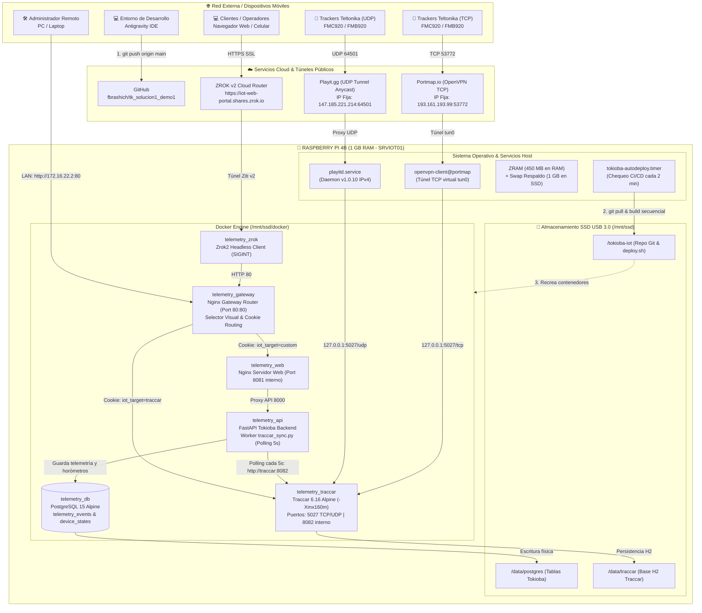

# Guía Definitiva de Despliegue en Raspberry Pi 4B (1 GB RAM, 64-bit)
## Arquitectura Híbrida (MicroSD + SSD USB 3.0) con CI/CD Totalmente Automático desde GitHub

Esta guía detalla la implementación completa para la plataforma telemática **Tokioba IoT** en una **Raspberry Pi 4 Model B (1 GB RAM)** con:
1. **MicroSD de 8 GB:** Exclusiva para el arranque (*boot*) y el sistema operativo base en modo casi de solo lectura.
2. **SSD de 120 GB (USB 3.0):** Montado en `/mnt/ssd` para el Swap de respaldo, el motor Docker (`data-root`), la base de datos PostgreSQL y el repositorio Git.
3. **Despliegue Continuo (CI/CD) 100% Automático:** Desarrollas en **Antigravity** desde cualquier PC o Laptop, haces `git push origin main` a GitHub, y la Raspberry Pi detecta los cambios, compila y se actualiza sola sin que tengas que conectarte por SSH.

---

## 1. Topología del Sistema y Flujo de Desarrollo

La arquitectura implementada conecta la capa de desarrollo en la nube con la Raspberry Pi 4B física y despliega canales de ingesta telemática directa mediante túneles públicos con IPs numéricas fijas, recepción en Traccar autónomo, persistencia en PostgreSQL y acceso web con SSL mediante ZROK.

### 1.1 Diagrama Integral del Despliegue Armado



### 1.2 Resumen de Componentes y Puertos del Despliegue

| Componente | Rol en la Arquitectura | Dirección / Puerto Externo | Destino en la Raspberry Pi |
| :--- | :--- | :--- | :--- |
| **Ingesta TCP Teltonika** | Portmap.io over OpenVPN | **`193.161.193.99:53772`** | `0.0.0.0:5027/tcp` $\rightarrow$ `telemetry_traccar` |
| **Ingesta UDP Teltonika** | Playit.gg Anycast Tunnel | **`147.185.221.214:64501`** | `0.0.0.0:5027/udp` $\rightarrow$ `telemetry_traccar` |
| **Gateway Router Nginx** | Único Puerto Web Expuesto (Selector & Router) | **`http://172.16.22.2:80`** (LAN) / ZROK | `0.0.0.0:80->80` $\rightarrow$ `telemetry_gateway` |
| **Dashboard Web Clientes** | ZROK v2 Public Share | **`https://iot-web-portal.shares.zrok.io`** | `telemetry_gateway:80` |
| **Plataforma Propia IoT** | Dashboard React + Proxy FastAPI | Enrutado por cookie (`iot_target=custom`) | Interno Docker (`telemetry_web:8081`) |
| **Consola Web Traccar** | Panel Administrativo Traccar | Enrutado por cookie (`iot_target=traccar`) | Interno Docker (`telemetry_traccar:8082`) |
| **API Backend Tokioba** | FastAPI REST & Sync | Interno Docker (`http://api:8000`) | `telemetry_api:8000` |
| **Base de Datos Principal** | Persistencia PostgreSQL | Interno Docker (`db:5432`) | `telemetry_db` $\rightarrow$ `/mnt/ssd/tokioba-iot/data/postgres` |
| **Base de Datos Traccar** | Almacenamiento Embebido | Local H2 | `telemetry_traccar` $\rightarrow$ `/mnt/ssd/tokioba-iot/data/traccar/data` |
| **Gestión Remota SSH** | Administración de Sistema | `172.16.22.2:22` (LAN) | `sshd` (Usuario `iot_admin_srv`) |

---

## 2. Requisitos de Hardware

1. **Raspberry Pi 4 Model B (1 GB RAM)**.
2. **Fuente de alimentación:** USB-C 5.1V / 3A (fuente oficial recomendada).
3. **Tarjeta MicroSD de 8 GB:** Para el arranque y sistema base.
4. **SSD de 120 GB con adaptador USB 3.0:** Conectado a uno de los **puertos USB azules** de la Pi.
5. **Conexión de red:** Cable Ethernet o Wi-Fi.

---

## 3. PASO 1: Flashear la MicroSD de 8 GB y Primer Arranque

1. Conectar la MicroSD de 8 GB a la PC.
2. Abrir **Raspberry Pi Imager** y seleccionar:
   * **Dispositivo:** *Raspberry Pi 4*.
   * **Sistema Operativo:** *Raspberry Pi OS (other)* $\rightarrow$ **Raspberry Pi OS Lite (64-bit)** (Debian Bookworm, sin entorno gráfico).
   * **Almacenamiento:** Tu MicroSD de 8 GB.
3. Hacer clic en **Siguiente** y seleccionar **"Editar ajustes"**:
   * **Hostname:** `SRVIOT01` (o el que elijas).
   * **Usuario y contraseña:** ej. usuario `iot_admin_srv`, contraseña segura.
   * **Habilitar SSH:** Seleccionar *Autenticación por contraseña*.
   * **Configurar Wi-Fi:** (si no usas cable de red).
4. Escribir la MicroSD.
5. Colocar la MicroSD en la Raspberry Pi, conectar red y alimentación. *(El SSD puede estar conectado).*
6. Conectarse por SSH desde la PC:
   ```bash
   ssh iot_admin_srv@SRVIOT01.local
   # O por IP: ssh iot_admin_srv@192.168.1.XX
   ```

---

## 4. PASO 2: Optimización de Memoria y Blindaje de la MicroSD

Dejamos el sistema operativo base protegido para que no desgaste la MicroSD y funcione con ZRAM ultrarrápido:

### 4.1 Eliminar el Swap de la MicroSD:
```bash
sudo systemctl stop dphys-swapfile
sudo systemctl disable dphys-swapfile
sudo apt purge -y dphys-swapfile
sudo rm -f /var/swap
```

### 4.2 Actualizar paquetes básicos e instalar herramientas:
```bash
sudo apt update && sudo apt install -y zram-tools curl git htop
```

### 4.3 Configurar ZRAM en RAM (Nivel 1 de Memoria, ~450 MB con `lzo-rle`):
```bash
# Cargar módulo zram
sudo modprobe zram

# Configurar algoritmo nativo lzo-rle para procesadores ARM al 50% de RAM
sudo bash -c 'cat <<EOF > /etc/default/zramswap
ALGO=lzo-rle
PERCENT=50
PRIORITY=100
CORES=4
EOF'

# Reiniciar servicio zram
sudo swapoff /dev/zram0 2>/dev/null
sudo systemctl restart zramswap
sudo systemctl enable zramswap
```

### 4.4 Optimizar parámetros del Kernel Linux (`sysctl`):
```bash
sudo bash -c 'cat <<EOF > /etc/sysctl.d/99-tokioba-memory.conf
vm.swappiness=100
vm.vfs_cache_pressure=50
vm.watermark_boost_factor=0
vm.dirty_background_ratio=5
vm.dirty_ratio=10
EOF'

sudo sysctl --system
```

### 4.5 Proteger la MicroSD de escrituras de Logs continuos:
```bash
sudo sed -i 's/#Storage=auto/Storage=volatile/' /etc/systemd/journald.conf
sudo sed -i 's/#SystemMaxUse=/SystemMaxUse=30M/' /etc/systemd/journald.conf
sudo systemctl restart systemd-journald
```

### 4.6 Verificar estado de memoria:
```bash
free -h
```
*Salida esperada:* ~720 MiB de RAM disponibles y 450 MiB de Swap ZRAM en `/dev/zram0`.

---

## 5. PASO 3: Conectar, Formatear y Montar el SSD de 120 GB

### 5.1 Identificar la unidad:
Conectar el SSD al puerto **USB 3.0 azul** y ejecutar:
```bash
lsblk
```
*(Verás la MicroSD como `mmcblk0` y el SSD como `sda` o `sda1`).*

### 5.2 Formatear en `ext4`:
```bash
sudo mkfs.ext4 -F -L TOKIOBA_SSD /dev/sda1
# (Si no tiene partición sda1 y figura como /dev/sda, usar /dev/sda)
```

### 5.3 Configurar automontaje seguro con `nofail`:
1. Crear el punto de montaje:
   ```bash
   sudo mkdir -p /mnt/ssd
   ```
2. Obtener el UUID del SSD:
   ```bash
   sudo blkid /dev/sda1
   ```
   *(Copia el valor entre comillas: `UUID="xxxx-xxxx-xxxx"`).*
3. Editar `/etc/fstab`:
   ```bash
   sudo nano /etc/fstab
   ```
   Agregar esta línea al final:
   ```text
   UUID=tu-uuid-aqui  /mnt/ssd  ext4  defaults,noatime,nofail  0  2
   ```
   *(La opción `nofail` garantiza que la Pi siempre arranque y permita SSH incluso si el disco USB se retrasa al encender).*
4. Montar y asignar permisos:
   ```bash
   sudo mount -a
   sudo chown -R $USER:$USER /mnt/ssd
   df -h /mnt/ssd
   ```

---

## 6. PASO 4: Crear el Swap Secundario en el SSD (Nivel 2)

Creamos un archivo de 1 GB de desborde en el SSD con prioridad baja (`pri=10`):

```bash
# 1. Crear el archivo en el SSD
sudo fallocate -l 1G /mnt/ssd/swapfile
sudo chmod 600 /mnt/ssd/swapfile
sudo mkswap /mnt/ssd/swapfile

# 2. Agregar a /etc/fstab con prioridad 10
sudo bash -c 'echo "/mnt/ssd/swapfile none swap sw,pri=10,nofail 0 0" >> /etc/fstab'

# 3. Activar y verificar
sudo swapon -a
swapon --show
free -h
```
*Resultado:*
* `/dev/zram0` (prioridad 100): Se usa primero a máxima velocidad de procesador.
* `/mnt/ssd/swapfile` (prioridad 10): Entra solo en picos extremos.

---

## 7. PASO 5: Instalar Docker y Mudar su Raíz al SSD

Para que ninguna imagen ni capa ocupe espacio en la MicroSD:

```bash
# 1. Instalar Docker oficial
curl -fsSL https://get.docker.com -o get-docker.sh
sudo sh get-docker.sh
sudo usermod -aG docker $USER

# 2. Configurar la raíz de Docker en el SSD
sudo mkdir -p /mnt/ssd/docker
sudo bash -c 'cat <<EOF > /etc/docker/daemon.json
{
  "data-root": "/mnt/ssd/docker",
  "log-driver": "json-file",
  "log-opts": {
    "max-size": "10m",
    "max-file": "3"
  }
}
EOF'

# 3. Reiniciar Docker y salir para aplicar permisos de grupo
sudo systemctl daemon-reload
sudo systemctl restart docker
exit
```

Reconéctate por SSH (`ssh iot_admin_srv@SRVIOT01.local`) y valida:
```bash
docker info | grep "Docker Root Dir"
# Debe responder: Docker Root Dir: /mnt/ssd/docker
```

---

## 8. PASO 6: Clonar el Repositorio de GitHub en el SSD

Ahora que el SSD y Docker están listos, clonamos el proyecto directamente desde GitHub:

```bash
cd /mnt/ssd
git clone https://github.com/fbrashich/tk_solucion1_demo1.git tokioba-iot
cd /mnt/ssd/tokioba-iot
```

---

## 9. PASO 7: Configuración de `docker-compose.pi.yml`

Verificamos que el archivo `docker-compose.pi.yml` esté presente dentro de `/mnt/ssd/tokioba-iot/`. Si necesitas crearlo o ajustarlo, esta es la configuración definitiva optimizada para compilación autónoma y bajo consumo de RAM:

```yaml
services:
  # Base de Datos PostgreSQL (en SSD)
  db:
    image: postgres:15-alpine
    container_name: telemetry_db
    restart: unless-stopped
    environment:
      POSTGRES_USER: postgres
      POSTGRES_PASSWORD: postgres
      POSTGRES_DB: telemetry
    volumes:
      - /mnt/ssd/tokioba-iot/data/postgres:/var/lib/postgresql/data
    command: >
      postgres 
      -c shared_buffers=24MB 
      -c work_mem=4MB 
      -c maintenance_work_mem=16MB 
      -c max_connections=20
      -c checkpoint_completion_target=0.7
    deploy:
      resources:
        limits:
          memory: 100M
    logging:
      driver: "json-file"
      options:
        max-size: "10m"
        max-file: "3"

  # Backend FastAPI Tokioba
  api:
    build:
      context: ./backend
      dockerfile: Dockerfile
    container_name: telemetry_api
    restart: unless-stopped
    environment:
      - DATABASE_URL=postgresql+asyncpg://postgres:postgres@db:5432/telemetry
      - SECRET_KEY=tokioba_super_secret_pi_key_2026
      - ALGORITHM=HS256
      - ACCESS_TOKEN_EXPIRE_MINUTES=1440
      - TRACCAR_URL=https://demo4.traccar.org
      - TRACCAR_EMAIL=fabianb@tokioba.com
      - TRACCAR_PASSWORD=Radius@1290!
      - TRACCAR_TOKEN=ehbiEoV1hUuCqWIQu0bpWZ:APA91bEoJ55-LLnp_udh3ZXpQXua_GfSup_Ttoh8_Ms_-iQUnOzNpbWgqq4wHFDyPjFYpjlXiksyI704909AB7fCbzOAxnBjH7_ULR9Zw4xo2A_YpATk3dA
      - TRACCAR_SYNC_INTERVAL=5
    ports:
      - "8000:8000"
    depends_on:
      - db
    deploy:
      resources:
        limits:
          memory: 120M
    logging:
      driver: "json-file"
      options:
        max-size: "10m"
        max-file: "3"

  # Servidor Web Nginx (Compila frontend automáticamente dentro de Docker)
  web:
    build:
      context: ./frontend
      dockerfile: Dockerfile
    container_name: telemetry_web
    restart: unless-stopped
    ports:
      - "3000:80"
    depends_on:
      - api
    deploy:
      resources:
        limits:
          memory: 30M
    logging:
      driver: "json-file"
      options:
        max-size: "5m"
        max-file: "2"

  # Túnel Público Seguro para el Dashboard Web (ZROK)
  zrok:
    image: openziti/zrok2:latest
    container_name: telemetry_zrok
    restart: unless-stopped
    stop_signal: SIGINT
    stop_grace_period: 20s
    depends_on:
      - web
    volumes:
      - ${HOME}/.zrok2:/home/ziggy/.zrok2
    command: share public http://web:80 -n public:iot-web-portal --headless
    deploy:
      resources:
        limits:
          memory: 30M
    logging:
      driver: "json-file"
      options:
        max-size: "5m"
        max-file: "2"
```

---

## 10. PASO 8: Primer Despliegue de la Plataforma

Creamos la carpeta para los datos de la base de datos y compilamos los servicios por separado para no saturar la memoria RAM:

```bash
mkdir -p /mnt/ssd/tokioba-iot/data/postgres
cd /mnt/ssd/tokioba-iot

# 1. Compilar primero el backend solo
docker compose -f docker-compose.pi.yml build api

# 2. Compilar el frontend solo
docker compose -f docker-compose.pi.yml build web

# 3. Levantar todo el stack (como ya están compilados, levanta en 3 segundos)
docker compose -f docker-compose.pi.yml up -d
```

*(Al compilar primero el backend y luego el frontend por separado, evitamos que Docker compile ambos al mismo tiempo y sature los 1 GB de RAM. El frontend tardará ~2-3 minutos en su etapa multi-stage).*

### Verificación de consumo de RAM:
```bash
docker stats --no-stream
free -h
```
* **Consumo de memoria total del stack:** **~105 MB de RAM**.
* **RAM libre para el sistema:** **> 730 MB**.
* **Acceso local:** Abre en tu navegador `http://SRVIOT01.local:3000`.

---

## 11. PASO 9: Automatización Total del Despliegue (CI/CD Automático)

Para que cualquier cambio que hagas desde tu PC (o cualquier laptop) se refleje en la Raspberry Pi sin tener que hacer nada manualmente, configuramos el **Auto-Deploy Inteligente**.

### 11.1 Crear el Script de Despliegue Inteligente (`deploy.sh`):
Este script compara el commit local de la Pi con el de GitHub. Si no hay cambios nuevos, termina en 1 segundo sin gastar CPU. Si detecta un commit nuevo, actualiza el código y recrea los contenedores:

```bash
cat << 'EOF' > /mnt/ssd/tokioba-iot/deploy.sh
#!/bin/bash
set -e
REPO_DIR="/mnt/ssd/tokioba-iot"
cd "$REPO_DIR"

# Traer información de GitHub silenciosamente
git fetch origin main >/dev/null 2>&1

LOCAL=$(git rev-parse HEAD)
REMOTE=$(git rev-parse origin/main)

if [ "$LOCAL" != "$REMOTE" ]; then
    echo "🚀 [$(date '+%Y-%m-%d %H:%M:%S')] Nuevos cambios detectados en GitHub ($LOCAL -> $REMOTE). Iniciando deploy..."
    
    # 1. Traer los cambios limpios
    git reset --hard origin/main
    
    # 2. Reconstruir secuencialmente (api primero, luego web) para proteger la RAM
    docker compose -f docker-compose.pi.yml build api
    docker compose -f docker-compose.pi.yml build web
    docker compose -f docker-compose.pi.yml up -d
    
    # 3. Limpiar imágenes viejas de Docker para no acumular espacio
    docker image prune -f >/dev/null 2>&1
    
    echo "✅ [$(date '+%Y-%m-%d %H:%M:%S')] Tokioba actualizado exitosamente."
else
    # Sin cambios nuevos
    exit 0
fi
EOF

chmod +x /mnt/ssd/tokioba-iot/deploy.sh
```

---

### 11.2 Activar el Auto-Deploy Desatendido (Systemd Timer cada 2 minutos):
Este es el mecanismo más confiable del mundo: la Raspberry Pi revisa silenciosamente GitHub cada 2 minutos. Si hiciste `git push`, se despliega sola. Si no hiciste push, el chequeo toma 0.2 segundos y consume 0 MB de memoria.

1. **Crear el servicio de Systemd:**
   ```bash
   sudo bash -c 'cat <<EOF > /etc/systemd/system/tokioba-autodeploy.service
   [Unit]
   Description=Tokioba IoT Auto-Deploy Checker
   After=network-online.target docker.service
   Wants=network-online.target

   [Service]
   Type=oneshot
   User=iot_admin_srv
   WorkingDirectory=/mnt/ssd/tokioba-iot
   ExecStart=/mnt/ssd/tokioba-iot/deploy.sh
   StandardOutput=journal
   StandardError=journal
   EOF'
   ```

2. **Crear el temporizador (Timer) de 2 minutos:**
   ```bash
   sudo bash -c 'cat <<EOF > /etc/systemd/system/tokioba-autodeploy.timer
   [Unit]
   Description=Chequear actualizaciones en GitHub cada 2 minutos

   [Timer]
   OnBootSec=1min
   OnUnitActiveSec=2min
   Persistent=true

   [Install]
   WantedBy=timers.target
   EOF'
   ```

3. **Habilitar y arrancar el Timer:**
   ```bash
   sudo systemctl daemon-reload
   sudo systemctl enable --now tokioba-autodeploy.timer
   ```

4. **Verificar que el Timer esté corriendo:**
   ```bash
   systemctl list-timers tokioba-autodeploy.timer
   ```
   *(Verás cuándo fue la última verificación y cuándo es la próxima).*

---

### 11.3 (Opcional) Método de Webhook Instantáneo de GitHub:
Si deseas que el deploy ocurra **al segundo exacto del push** en vez de esperar hasta 2 minutos:
1. Instalar el micro-servicio oficial `webhook` de Debian (escrito en Go, consume solo 3 MB de RAM):
   ```bash
   sudo apt install -y webhook
   ```
2. Configurar una regla en `/etc/webhook.conf` que apunte a `/mnt/ssd/tokioba-iot/deploy.sh`.
3. En la configuración de tu repositorio en GitHub $\rightarrow$ **Settings** $\rightarrow$ **Webhooks**, añades la URL de tu túnel Playit.

---

## 12. PASO 10: Flujo de Trabajo Diario desde Cualquier PC

Ahora tu flujo de trabajo como desarrollador es 100% libre:

1. **En cualquier PC o Laptop:**
   * Abres el proyecto en **Antigravity**.
   * Trabajas en tus mejoras, corriges bugs o agregas componentes.
2. **Subes tus cambios:**
   ```bash
   git commit -am "feat: agregada telemetría de combustible y alertas de motor"
   git push origin main
   ```
3. **¡Listo!**
   * No necesitas abrir SSH.
   * No necesitas copiar archivos con SCP.
   * La Raspberry Pi detecta el commit automáticamente, compila la nueva versión y la publica en vivo.

---

## 13. PASO 11: Exposición Externa Híbrida: Teltonika GPS (TCP Playit) + Web Dashboard (HTTP ZROK)

Para exponer la plataforma al mundo sin abrir puertos en el router hogareño/oficina, implementamos una solución híbrida especializada:
1. **Tráfico TCP (Rastreadores GPS Teltonika):** Vía **Portmap.io (OpenVPN)** por IP directa **`193.161.193.99:53772`**, probado y validado desde red celular 4G real.
2. **Tráfico UDP (Rastreadores GPS Teltonika):** Vía **Playit.gg** por IP directa **`147.185.221.214:64501`**, probado y validado desde red celular 4G real.
3. **Tráfico HTTP (Dashboard Web):** Vía **ZROK en Docker**, con SSL automático y URL fija reservada (`https://iot-web-portal.shares.zrok.io`).

> [!NOTE]
> Para evitar depender de resoluciones DNS o nombres de host largos en el firmware de los dispositivos GPS, **ambos canales operan de forma directa por dirección IP numérica**.

---

### 13.1 Solución TCP Definitiva para Rastreadores GPS Teltonika (Portmap.io OpenVPN)

Implementamos un túnel TCP nativo sobre **OpenVPN** mediante el servicio **Portmap.io**, probado y verificado exitosamente desde un teléfono móvil sobre red celular 4G:

* **IP Pública de Entrada Directa:** **`193.161.193.99`**
* **Puerto Público Externo:** **`53772`** *(TCP)*
* **Destino Local en la Raspberry Pi:** Puerto **`5027`** *(TCP)*
* **Interfaz Virtual en la Pi:** `tun0` (IP de túnel `10.9.0.x`)
* **Archivo de Configuración:** `federico_brashich.iot-tpc-demo.ovpn` (en la raíz del repositorio)

#### Pasos de Instalación y Activación en la Raspberry Pi:
1. **Actualizar el repositorio en la Pi:**
   ```bash
   cd /mnt/ssd/tokioba-iot
   git pull origin main
   ```

2. **Instalar OpenVPN:**
   ```bash
   sudo apt update && sudo apt install -y openvpn
   ```

3. **Copiar la configuración y activar el servicio persistente:**
   ```bash
   sudo mkdir -p /etc/openvpn/client
   sudo cp /mnt/ssd/tokioba-iot/federico_brashich.iot-tpc-demo.ovpn /etc/openvpn/client/portmap.conf
   sudo systemctl enable --now openvpn-client@portmap
   ```

4. **Verificar estado del túnel y la interfaz de red:**
   ```bash
   sudo systemctl status openvpn-client@portmap
   ip a show tun0
   ```
   *(El log confirmará `Initialization Sequence Completed` y la creación de `tun0`).*

5. **Configuración en los Rastreadores Teltonika (FMC920 / FMB920 por SMS o Teltonika Configurator):**
   * **Target Server IP:** **`193.161.193.99`** *(sin nombres de dominio)*
   * **Target Server Port:** **`53772`**
   * **Protocol:** **`TCP`**

---

### 13.2 Solución UDP para Rastreadores GPS Teltonika (Playit.gg)

Configuramos el agente de Playit en la Raspberry Pi con los parámetros asignados y **validados bidireccionalmente por IP**:

* **IP Pública de Entrada Directa:** **`147.185.221.214`**
* **Puerto Público Externo:** **`64501`** *(UDP)*
* **Destino Local en la Pi:** Puerto **`5027`** *(UDP)*
* **Proxy Protocol:** `None`

#### Pasos en la Raspberry Pi:
1. **Instalar / Actualizar Playit.gg al repositorio oficial:**
   ```bash
   curl -fsSL https://packages.playit.gg/install.sh | sudo bash
   ```

2. **Requisito Crítico: Sincronización Horaria NTP:**
   ```bash
   sudo timedatectl set-timezone America/Argentina/Buenos_Aires
   sudo timedatectl set-ntp true
   sudo systemctl restart systemd-timesyncd
   timedatectl
   ```

3. **Requisito de Conectividad: Desactivar IPv6 (Forzar IPv4 puro):**
   ```bash
   sudo tee /etc/sysctl.d/99-disable-ipv6.conf <<EOF
   net.ipv6.conf.all.disable_ipv6 = 1
   net.ipv6.conf.default.disable_ipv6 = 1
   net.ipv6.conf.lo.disable_ipv6 = 1
   EOF
   sudo sysctl --system
   sudo systemctl restart playit
   ```

4. **Habilitar Playit como servicio del sistema en segundo plano:**
   ```bash
   sudo systemctl enable --now playit
   sudo systemctl status playit
   ```

5. **Configuración en los Rastreadores Teltonika (Modo UDP):**
   * **Target Server IP:** **`147.185.221.214`** *(sin nombres de dominio)*
   * **Target Server Port:** **`64501`**
   * **Protocol:** **`UDP`**

---

### 13.3 Script de Verificación Dual en la Raspberry Pi (`receiver_demo.py`)

Incluido en el repositorio para validar en cualquier momento la llegada de paquetes de telemetría a ambos túneles simultáneamente:

```bash
cd /mnt/ssd/tokioba-iot
python3 receiver_demo.py
```

**Evidencia de Verificación Exitosa en Vivo (Red Móvil 4G):**
```text
=================================================================
  TOKIOBA IoT - RECEPTOR DUAL TELEMETRÍA (PUERTO 5027)
  TCP: Portmap.io -> 193.161.193.99:53772
  UDP: Playit.gg  -> 147.185.221.214:64501
=================================================================
>>> [UDP] Receptor activo escuchando en 0.0.0.0:5027 (Playit.gg)
>>> [TCP] Receptor activo escuchando en 0.0.0.0:5027 (Portmap.io)
[2026-10-17 16:25:47] [TCP] Conexión desde: ('10.9.0.1', 28412) | Datos (20 bytes): hola desde celular 3
[2026-10-17 16:26:32] [UDP] Conexión desde: ('127.255.179.93', 56514) | Datos (17 bytes): udp desde celular
```

---

### 13.4 Solución HTTP para el Web Dashboard (ZROK en Docker)

Recuperamos la configuración de **ZROK** probada en la PC (`openziti/zrok2:latest`), logrando una URL pública con SSL automático y reservada bajo el alias `public:iot-web-portal`.

#### 1. Transferir las credenciales de ZROK desde tu PC a la Raspberry Pi:
Para que la Raspberry Pi no tenga que registrar una cuenta nueva ni pierda el nombre reservado, copiamos la identidad existente de tu PC:

* **Desde tu PC con Windows (abrir PowerShell):**
  ```powershell
  # Copiar la carpeta .zrok2 de tu usuario de Windows al home de la Raspberry Pi:
  scp -r $env:USERPROFILE\.zrok2 iot_admin_srv@SRVIOT01.local:~/.zrok2
  ```

#### 2. Verificar el servicio ZROK en `docker-compose.pi.yml`:
El servicio ya está añadido al Compose y mapea automáticamente tu identidad desde `${HOME}/.zrok2`:
```yaml
  zrok:
    image: openziti/zrok2:latest
    container_name: telemetry_zrok
    restart: unless-stopped
    stop_signal: SIGINT
    stop_grace_period: 20s
    depends_on:
      - gateway
    volumes:
      - ${HOME}/.zrok2:/home/ziggy/.zrok2
    command: share public http://gateway:80 -n public:iot-web-portal --headless
    deploy:
      resources:
        limits:
          memory: 30M
```

#### 3. Levantar el túnel ZROK en la Raspberry Pi:
```bash
cd /mnt/ssd/tokioba-iot
docker compose -f docker-compose.pi.yml up -d zrok
```

#### 4. Validar el enlace en vivo:
```bash
docker logs -f telemetry_zrok
```
*Verás la confirmación de la sesión compartida con tu URL pública activa (ej. `https://iot-web-portal.shares.zrok.io`), lista para ser accedida desde cualquier navegador o teléfono móvil sin restricciones de red.*

#### 5. Gestión y Solución de Problemas: Cambiar o Crear un Nuevo Share en ZROK

##### ¿Por qué puede aparecer el error `unable to create share` o `the zrok service is busy, retry shortly`?
1. **Conflicto con el entorno de Windows o nombre ocupado:** Al transferir la identidad `.zrok2` desde la PC, el servidor de Zrok puede detectar que el alias (o la identidad de ese entorno) todavía figura en uso por una sesión previa o superó el límite de peticiones simultáneas.
2. **Nombre no reservado en el namespace (Zrok v2):** En Zrok v2, cualquier nombre especificado con `-n public:<alias>` debe existir previamente registrado en tu cuenta (`zrok create name -n public <alias>`). Si no fue creado, devolverá `name '<alias>' not found in namespace 'public'`.
3. **Bucle de reintentos (Rate Limit HTTP 429):** Como el contenedor `telemetry_zrok` tiene `restart: unless-stopped`, si falla al iniciar intentará reconectarse inmediatamente una y otra vez. Eso satura la API de Zrok, provocando un bloqueo temporal por ráfagas (`the zrok service is busy, retry shortly`).

##### Procedimiento paso a paso para cambiar o recrear un share limpio:

1. **Frenar el contenedor `telemetry_zrok` para cortar el bucle:**
   ```bash
   docker compose -f docker-compose.pi.yml stop zrok
   ```
   *Verificación:* Al ejecutar `docker ps`, ya no debe figurar `telemetry_zrok` activo.

2. **Liberar y registrar el nuevo nombre:**
   > [!IMPORTANT]
   > Si aún tienes corriendo un contenedor de Zrok en Docker Desktop en tu PC de Windows, apágalo primero para que ambas máquinas no compitan por el mismo túnel.

   ```bash
   # 1. Ver qué nombres tienes creados en la cuenta y si tienen un share activo asociado:
   docker compose -f docker-compose.pi.yml run --rm zrok list names

   # 2. Si el nombre quedó tomado o deseas recrearlo limpio:
   docker compose -f docker-compose.pi.yml run --rm zrok delete name -n public iot-web-portal
   docker compose -f docker-compose.pi.yml run --rm zrok create name -n public iot-web-portal
   ```
   *Verificación:* La terminal devolverá `deleted name 'iot-web-portal'` y luego `created name 'iot-web-portal' in namespace 'public'`.

3. **Esperar 60 segundos y volver a levantar el servicio:**
   Espera 1 minuto de reloj para que expire cualquier bloqueo temporal (*service is busy*) en los servidores de Zrok y levanta el contenedor:
   ```bash
   docker compose -f docker-compose.pi.yml up -d zrok
   docker logs -f telemetry_zrok
   ```
   *Verificación:* El log confirmará la sesión compartida:
   `access your zrok share at the following endpoints: iot-web-portal.shares.zrok.io`

#### 6. Blindaje Permanente contra Reinicios del Sistema y Cortes de Energía

##### ¿Por qué fallaba Zrok al reiniciar la Raspberry Pi?
1. **La causa técnica:** Por defecto, al ejecutar `sudo reboot` o apagarse el equipo, Docker envía una señal `SIGTERM` y apaga los contenedores en paralelo en pocos segundos.
2. **El problema de señal en Zrok:** Las aplicaciones desarrolladas en Go (como Zrok 2) escuchan específicamente la señal **`SIGINT`** (el equivalente a presionar `Ctrl + C` en la terminal) para ejecutar su rutina de cierre limpio (*unshare hook*), contactar a `api.zrok.io` y liberar el nombre reservado.
3. **El conflicto resultante:** Al apagarse abruptamente con `SIGTERM` o cortarse la red antes de notificar a la nube, el servidor central de Zrok retenía el share anterior como "en uso". Al reiniciar la Pi, Docker intentaba crear un share nuevo con el mismo nombre y era rechazado con el error:  
   `[ERROR]: unable to create share (name 'iot-web-portal' in namespace 'public' is in use by share '...'; run 'zrok2 delete share ...' to release it)`.

##### La Solución Aplicada en `docker-compose.pi.yml`:
Se añadieron dos directivas clave al servicio `zrok`:
```yaml
  zrok:
    image: openziti/zrok2:latest
    container_name: telemetry_zrok
    restart: unless-stopped
    stop_signal: SIGINT         # 1. Envía SIGINT (Ctrl+C) para disparar el hook de cierre limpio de Zrok
    stop_grace_period: 20s      # 2. Otorga 20 segundos para que Zrok complete la desconexión HTTP con api.zrok.io
    ...
```

##### Beneficios del Blindaje:
* **Reinicios 100% Desatendidos:** Puedes ejecutar `sudo reboot`, reiniciar por actualización del kernel o sufrir un reinicio imprevisto, y el túnel Zrok volverá a estar en línea automáticamente sin intervención manual ni errores de nombres retenidos.
* **Cero Rate-Limit:** Al cerrar de forma limpia, el contenedor no entra en bucle de reintentos infinitos, evitando bloqueos por *service is busy*.
* **Persistencia Total:** Tu URL fija `https://iot-web-portal.shares.zrok.io` siempre estará lista para recibir tráfico.

---

### 13.5 Ingestor Telemático Autónomo (Traccar Alpine en Docker)

Se eliminó completamente la dependencia de servidores demo externos (`demo4.traccar.org`), integrando un contenedor Traccar nativo ultraliviano para procesar telemetría Teltonika (Codec 8 / Codec 8 Extended) de forma 100% local en la Raspberry Pi.

#### 1. Topología de Red y Enrutamiento Local
* **Ingesta TCP (Portmap.io OpenVPN):** IP pública `193.161.193.99:53772` $\rightarrow$ Pi `0.0.0.0:5027/tcp` $\rightarrow$ Traccar contenedor `5027/tcp`.
* **Ingesta UDP (Playit.gg):** IP pública `147.185.221.214:64501` $\rightarrow$ Pi `0.0.0.0:5027/udp` $\rightarrow$ Traccar contenedor `5027/udp`.
* **API REST & Sincronización Interna:** Puerto `8082` expuesto en la red bridge interna de Docker (`http://traccar:8082`).

#### 2. Configuración Optimizada de Traccar (`traccar/traccar.xml`)
Se definió almacenamiento embebido H2 persistente en SSD (`/mnt/ssd/tokioba-iot/data/traccar/data`), registro automático de trackers no catalogados (`database.registerUnknown=true`) y optimización de rendimiento:
```xml
<?xml version="1.0" encoding="UTF-8"?>
<!DOCTYPE properties SYSTEM 'http://java.sun.com/dtd/properties.dtd'>
<properties>
    <entry key='database.driver'>org.h2.Driver</entry>
    <entry key='database.url'>jdbc:h2:./data/traccar;DB_CLOSE_DELAY=-1;DEFRAG_ALWAYS=TRUE</entry>
    <entry key='database.user'>sa</entry>
    <entry key='database.password'></entry>
    <entry key='database.registerUnknown'>true</entry>
    <entry key='teltonika.port'>5027</entry>
    <entry key='teltonika.timeout'>120</entry>
    <entry key='web.port'>8082</entry>
    <entry key='web.path'>./web</entry>
    <entry key='geocoder.enable'>false</entry>
    <entry key='filter.enable'>false</entry>
</properties>
```

#### 3. Restricciones Estrictas de RAM (JVM en Raspberry Pi 1 GB)
Traccar corre con imagen oficial ARM64 `traccar/traccar:alpine` con límites acotados:
* `JAVA_TOOL_OPTIONS`: `-Xms48m -Xmx160m -XX:+UseSerialGC`
* Límite en Docker Compose: `memory: 220M`

#### 4. Auto-Inicialización y Sincronizador Bidireccional (`traccar_sync.py`)
El servicio backend en FastAPI detecta automáticamente si Traccar es nuevo (`newServer: true`), crea el usuario administrador (`admin@tokioba.com` / `tokioba_admin_2026`) sin intervención manual, registra en Traccar los dispositivos existentes en PostgreSQL y actualiza las tablas `telemetry_events` y `device_states` cada 5 segundos.

---

### 13.6 Acceso y Administración Remota de la Consola Web de Traccar

El contenedor Traccar procesa la ingesta de telemetría directamente por los puertos 5027 TCP/UDP y expone su consola web administrativa y API REST internamente en el puerto **`8082`**. 

Gracias a la implementación del **Gateway Router Nginx en el puerto 80**, ya no es necesario lidiar con números de puerto diferentes ni abrir túneles complejos para acceder a Traccar.

#### Credenciales Maestras de Acceso a Traccar
* **Email / Usuario:** `admin@tokioba.com`
* **Contraseña:** `tokioba_admin_2026`

---

#### Método 1: Acceso Directo Unificado en Puerto 80 (LAN o Internet ZROK) — *Método Oficial y Recomendado*
Puedes ingresar tanto en la red local como desde cualquier parte del mundo mediante el Gateway único:

1. **Desde la Red Local (LAN / Wi-Fi):**
   * Ingresa a `http://172.16.22.2/selector` (o `http://172.16.22.2/` sin cookies).
   * Haz clic en **🛰️ Consola Traccar** (o directamente navega a `http://172.16.22.2/set-platform/traccar`).
   * Tu navegador guardará la cookie `iot_target=traccar` y accederás a la consola web completa de Traccar de inmediato en el puerto 80 estándar.

2. **Desde el Exterior mediante ZROK (HTTPS Seguro con SSL):**
   * Ingresa a tu URL pública: `https://iot-web-portal.shares.zrok.io/selector`.
   * Pulsa **🛰️ Consola Traccar** para acceder a Traccar con cifrado SSL sin abrir puertos en el router.

3. **Salto Inmediato con 1 Clic desde Nuestra Plataforma:**
   * Cuando estés dentro de nuestra plataforma web Tokioba IoT, en la barra superior (navbar) verás el botón **🛰️ Traccar**. Al pulsarlo, el Gateway te redirige automáticamente a la consola de Traccar.

---

#### Método 2: Túnel Seguro SSH (Port Forwarding para Consola Interna) — *Fallback Técnico*
Si necesitas depuración técnica directa al socket interno de Jetty sin pasar por Nginx:
1. Desde tu PC remota (PowerShell en Windows o Terminal en Linux/Mac), reenvía el puerto 8082 interno de Docker:
   ```powershell
   ssh -i $env:USERPROFILE\.ssh\id_ed25519_tokioba -L 8082:localhost:8082 iot_admin_srv@172.16.22.2
   ```
2. Mantén esa ventana de terminal abierta e ingresa en tu navegador a:
   ```
   http://localhost:8082
   ```

---

### 13.7 Gateway Router Nginx en Puerto 80 (Selector Visual y Enrutamiento por Cookie)

Para resolver la convivencia de dos aplicaciones Single Page Application (SPA) que utilizan rutas absolutas `/api/...` y WebSockets (`/api/socket`), se implementó un **Gateway Router en el puerto 80** basado en Nginx con enrutamiento total por cookie (`iot_target`).

```text
                                 ┌──> [iot_target=custom]  ──> Plataforma Tokioba (8081)
CLIENTE ──> Gateway Nginx (80) ──┤
                                 └──> [iot_target=traccar] ──> Consola Traccar   (8082)
                                 └──> [sin cookie]         ──> 302 a /selector
```

#### 1. Características Técnicas Implementadas:
* **Resolución DNS Dinámica Docker:** Utiliza `resolver 127.0.0.11 valid=30s ipv6=off;` para resolver en tiempo de ejecución los contenedores `web` y `traccar` sin fallos si se reinician con nuevas IPs internas.
* **Mapeo por Cookie (`map $cookie_iot_target`):**
  * `"custom"` $\rightarrow$ enruta el 100% del tráfico al servicio web de Tokioba (`http://web:8081`).
  * `"traccar"` $\rightarrow$ enruta el 100% del tráfico a Traccar (`http://traccar:8082`).
  * `default` $\rightarrow$ redirige automáticamente al selector visual (`/selector`).
* **Soporte Nativo de WebSockets (RFC 6455):** Cabeceras `Upgrade $http_upgrade` y `Connection $connection_upgrade` configuradas con timeouts extendidos (`86400s`) para evitar desconexiones en las alertas y mapas en vivo de Traccar (`/api/socket`).
* **Prevención Estricta de Caché:** Endpoints de control con cabeceras `Cache-Control: no-store, no-cache, must-revalidate` para que los navegadores nunca almacenen respuestas intermedias.

#### 2. Endpoints del Gateway Router:
| Endpoint | Método | Función |
| :--- | :--- | :--- |
| **`/`** | GET | Router principal. Si no hay cookie fijada, redirige `302 /selector`. Si hay cookie, enruta al upstream correspondiente. |
| **`/selector`** | GET | Pantalla visual en modo oscuro (`#0b0f19` / `#1e293b`) con botones interactivos para elegir plataforma. |
| **`/set-platform/custom`** | GET | Fija la cookie `iot_target=custom` (vigencia 24h) y redirige `302 /`. |
| **`/set-platform/traccar`** | GET | Fija la cookie `iot_target=traccar` (vigencia 24h) y redirige `302 /`. |
| **`/logout-platform`** | GET | Borra la cookie `iot_target` y redirige `302 /selector` para volver a elegir. |

#### 3. Verificación Rápida de Salud con `curl`:
```bash
# 1. Sin cookies debe enviar al selector:
curl -I http://172.16.22.2:80/

# 2. Selector visual debe responder 200 OK:
curl -I http://172.16.22.2:80/selector

# 3. Fijar plataforma custom:
curl -I http://172.16.22.2:80/set-platform/custom

# 4. Consumir con cookie custom (responde React y FastAPI):
curl -i -b "iot_target=custom" http://172.16.22.2:80/

# 5. Consumir con cookie traccar (responde Traccar):
curl -i -b "iot_target=traccar" http://172.16.22.2:80/
```

---

## 14. Comandos Esenciales de Monitoreo y Mantenimiento

| Acción | Comando en la Raspberry Pi |
| :--- | :--- |
| **Ver logs del Auto-Deploy automático** | `journalctl -u tokioba-autodeploy.service -e -f` |
| **Ver cuándo correrá el próximo chequeo** | `systemctl list-timers tokioba-autodeploy.timer` |
| **Forzar despliegue manual inmediato** | `/mnt/ssd/tokioba-iot/deploy.sh` |
| **Ver estado de los contenedores Docker** | `docker compose -f /mnt/ssd/tokioba-iot/docker-compose.pi.yml ps` |
| **Ver consumo de RAM en tiempo real** | `docker stats` |
| **Ver logs del backend en vivo** | `docker logs -f telemetry_api` |
| **Ver temperatura del procesador** | `vcgencmd measure_temp` |
| **Ver estado de la memoria y swaps** | `free -h && swapon --show` |
| **Hacer backup de la base de datos** | `docker exec telemetry_db pg_dump -U postgres telemetry > /mnt/ssd/backup_$(date +%F).sql` | 
